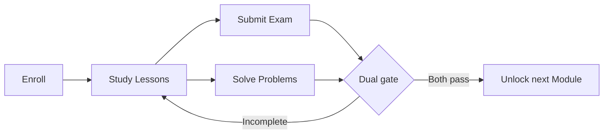

<div align="center">
  <picture>
    <source media="(prefers-color-scheme: dark)" srcset=".github/assets/banner-dark.svg">
    
  </picture>

  <p>
    <a href="https://github.com/Tawjjeh/TalebElm/actions/workflows/ci.yml"></a>
    <a href="LICENSE"></a>
    <a href="https://github.com/Tawjjeh/TalebElm/discussions"></a>
  </p>

  [How it works](#how-it-works) · [Status](#status) · [Quick start](#quick-start) · [Architecture](#architecture) · [Contributing](#contributing)
</div>

**Learn software engineering. Earn every step.**

TalebElm is an open-source learning path for software engineers: ordered tracks, real exams, and practice that is checked before the next step opens.

## How it works

- Enroll in a published Track and study its Lessons in order.
- Take the server-graded Exam at the end of each Module.
- Solve the assigned Codeforces problems and GitHub tasks; both are verified automatically.
- When the exam gate and the problem gate both hold, the next Module unlocks, forward-only.
- A Track is complete when every Module is passed and every Capstone milestone is verified.



The rule, from [business rule P-2](docs/business/BUSINESS_RULES.md#6-progress-tracking-unlock) and [Decision 32](docs/OPEN_DECISIONS.md):

```text
examGate    = !hasExam || PassedExam
problemGate = !hasRequiredProblems || CompletedRequiredProblems
unlockNext  = (hasExam || hasRequiredProblems) && examGate && problemGate && nextModuleExists
```

Progress is sticky: a later failed retake never clears a pass or a completion.

## Status

The backend is a work in progress. [`docs/FEATURE_INDEX.md`](docs/FEATURE_INDEX.md) lists what is implemented, target, or proposed per feature. Work is tracked in six milestones:

| Milestone | Scope |
|---|---|
| [M0 Foundations](https://github.com/Tawjjeh/TalebElm/milestone/1) | DI baseline, error mapping, cancellation, CI health |
| [M1 Identity](https://github.com/Tawjjeh/TalebElm/milestone/2) | Registration, login, JWT, authorization policies |
| [M2 Learning flow](https://github.com/Tawjjeh/TalebElm/milestone/3) | Tracks, Modules, Lessons, Exams, Progress, unlocking |
| [M3 Automated Verification](https://github.com/Tawjjeh/TalebElm/milestone/4) | External accounts, Codeforces, GitHub tasks, dual gate |
| [M4 Public Resource Hub](https://github.com/Tawjjeh/TalebElm/milestone/5) | Technology tree, anonymous browse, admin curation |
| [M5 Capstone Projects](https://github.com/Tawjjeh/TalebElm/milestone/6) | Milestone verification, derived Track completion |

## Quick start

Requires the [.NET 10 SDK](https://dotnet.microsoft.com/download), Git, and Python 3 for the docs check.

```bash
git clone https://github.com/Tawjjeh/TalebElm.git
cd TalebElm
dotnet build TalebElm.slnx
dotnet test TalebElm.slnx
dotnet run --project src/TalebElm.Api
```

Then check `curl http://localhost:5236/api/health` and open <http://localhost:5236/swagger>. Local database settings are in [`docs/LOCAL_SETUP.md`](docs/LOCAL_SETUP.md).

## Architecture

Dependencies point inward. Domain has no dependencies; Application depends on Domain; Infrastructure implements Application contracts; Api composes them.

| Layer | Project | Owns |
|---|---|---|
| Api | `src/TalebElm.Api` | Controllers, middleware, `Program.cs` |
| Infrastructure | `src/TalebElm.Infrastructure` | EF Core, migrations, repositories, HTTP clients |
| Application | `src/TalebElm.Application` | Services, DTOs, validators, client interfaces |
| Domain | `src/TalebElm.Domain` | Entities, enums, exceptions, repository interfaces |

[`ARCHITECTURE.md`](ARCHITECTURE.md) has the full rules and examples.

## Contributing

Pick an open issue that has a milestone, no assignee, and no open pull request ([browse ready issues](https://github.com/Tawjjeh/TalebElm/issues?q=is%3Aissue+is%3Aopen+no%3Aassignee+-no%3Amilestone+NOT+%22%5BTracking%5D%22+in%3Atitle)). Comment how you plan to change it and start; the first pull request that meets the guide wins. Start with [`good first issue`](https://github.com/Tawjjeh/TalebElm/issues?q=is%3Aissue+is%3Aopen+label%3A%22good+first+issue%22+no%3Aassignee), and read [`CONTRIBUTING.md`](CONTRIBUTING.md) for the full flow.

Questions and post-MVP ideas belong in [Discussions](https://github.com/Tawjjeh/TalebElm/discussions). Security problems follow [`SECURITY.md`](SECURITY.md).

## License

TalebElm is copyright © 2026 Abdulrahman Hossam and Twajjeh Contributors. Licensed under the [GNU General Public License, version 3](LICENSE).
