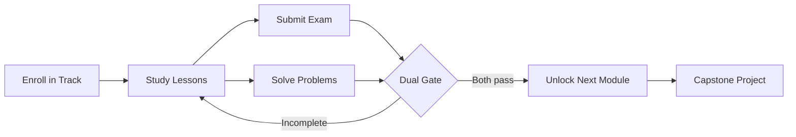

<div align="center">
  <picture>
    <source media="(prefers-color-scheme: dark)" srcset=".github/assets/banner-dark.svg">
    
  </picture>
</div>

<div align="center">

[](https://github.com/Tawjjeh/TalebElm/actions/workflows/ci.yml)
[](LICENSE)
[](https://dotnet.microsoft.com/download)
[](https://github.com/Tawjjeh/TalebElm/discussions)

</div>

<div align="center">

[What it does](#what-it-does) &bull; [Learner loop](#learner-loop) &bull; [Unlock rule](#progression-unlock-rule) &bull; [Feature pillars](#feature-pillars) &bull; [Status](#project-status) &bull; [Quick start](#quick-start) &bull; [Architecture](#architecture) &bull; [Documentation](#documentation) &bull; [Contributing](#contributing)

</div>

---

**TalebElm** (Arabic: طالب علم, literally *"seeker of knowledge"*) is an open-source .NET 10 Clean Architecture backend for a programming learning platform where the server, not a checkbox, decides when you unlock the next module.

## What it does

Most online roadmaps are passive lists, and video courses encourage tutorial hell by letting learners binge content without writing independent code. TalebElm enforces authentic competence through **zero manual gating**:

- A learner enrolls in an ordered Track and studies its Lessons.
- At the end of each Module, the learner completes two gates: a server-graded knowledge Exam and assigned practice problems.
- Practice problems are verified automatically: algorithmic fundamentals via the public Codeforces API, and framework tasks via GitHub Actions workflow and SHA integrity checks.
- When both gates hold, the next Module unlocks. Unlocks are forward-only and sticky.
- Completing all Track Modules unlocks the cumulative Capstone project, leading to derived Track completion.

## Learner loop



## Progression unlock rule

A Module unlocks its successor if and only if both its exam gate and its problem gate hold, evaluated inside an atomic UnitOfWork transaction as specified in [Decision 32](docs/OPEN_DECISIONS.md) and [Business Rule P-2](docs/business/BUSINESS_RULES.md#6-progress-tracking-unlock):

```text
examGate    = !hasExam || PassedExam
problemGate = !hasRequiredProblems || CompletedRequiredProblems
unlockNext  = (hasExam || hasRequiredProblems) && examGate && problemGate && nextModuleExists
```

Progress is sticky and forward-only: passing an exam or completing required problems is permanent and cannot be revoked by a later retake.

## Feature pillars

| Pillar | Scope | Mechanical guarantee |
|---|---|---|
| **Guided Tracks** | Ordered Tracks &rarr; Modules &rarr; Lessons with authored explanations and curated references (`LessonResource`). | Enforced sequence: learners cannot skip ahead, and published tracks require explicit enrollment. |
| **Knowledge Exams** | Multiple-choice exams testing conceptual understanding. | Server-side grading only: answer keys (`IsCorrect`) are never sent to clients or logged. Latest score wins; pass is sticky. |
| **Automated Verification** | Codeforces algorithmic solves + GitHub repository tasks (CodeCrafters-style). | 100% automated: Codeforces `user.status` solves verified via public API; GitHub tasks verified via GitHub REST API for template provenance, workflow success, and SHA matches. |
| **Public Resource Hub** | 3-click anonymous hierarchy (`Language` &rarr; `Framework` &rarr; `Topic`) sharing one underlying `Resource` entity. | Zero login barrier for visitors; scheduled SSRF-safe link checker automatically flags broken URLs. |

## Project status

All current work is tracked under six MVP milestones:

| Milestone | Scope | Status | Done when |
|---|---|---|---|
| [**M0 Foundations**](https://github.com/Tawjjeh/TalebElm/milestone/1) | DI baseline, validation errors, content guards, cancellation tokens, logging, CI health | In Progress | Full-graph DI resolves cleanly, error mapping is uniform, blank-database migrations pass. |
| [**M1 Identity**](https://github.com/Tawjjeh/TalebElm/milestone/2) | Registration, login, signed JWT issuance, password policy, `StudentOnly` and `AdminOnly` policies | In Progress | Learner registers, logs in, reaches protected routes; 401/403/409 error contracts hold. |
| [**M2 Learning flow**](https://github.com/Tawjjeh/TalebElm/milestone/3) | Tracks, Modules, Lessons, Exams, Progress, server-side grading, sticky unlocking | In Progress | Full study loop works end-to-end and exam submission unlocks the next Module. |
| [**M3 Automated Verification**](https://github.com/Tawjjeh/TalebElm/milestone/4) | External accounts, Codeforces solve checks, GitHub OAuth, `TaskVersion` SHA integrity, dual-gate unlock | In Progress | Required Codeforces problems and GitHub tasks verify automatically and the dual gate evaluates. |
| [**M4 Public Resource Hub**](https://github.com/Tawjjeh/TalebElm/milestone/5) | Technology tree, Resource persistence, anonymous search/filter endpoints, Admin curation, link checker | In Progress | Anonymous visitors browse technologies in &le;3 clicks; Admins curate unified resources. |
| [**M5 Capstone Projects**](https://github.com/Tawjjeh/TalebElm/milestone/6) | Capstone and ProjectMilestone persistence, milestone verification via GitHub tasks, derived Track completion | In Progress | Learners complete ordered capstone milestones automatically; Track completion derives cleanly. |

For exact feature implementation status, see [`docs/FEATURE_INDEX.md`](docs/FEATURE_INDEX.md).

## Quick start

### Prerequisites

- [.NET 10 SDK](https://dotnet.microsoft.com/download) (or .NET 11 preview; `Directory.Build.props` enables major runtime roll-forward).
- Git.
- Python 3 (required only for the documentation audit script).

### Build, test, and run

```bash
git clone https://github.com/Tawjjeh/TalebElm.git
cd TalebElm
dotnet restore TalebElm.slnx
dotnet build TalebElm.slnx
dotnet test TalebElm.slnx
```

Run the API:

```bash
dotnet run --project src/TalebElm.Api
```

Verify the health check in another terminal:

```bash
curl http://localhost:5236/api/health
# healthy
```

In Development, the app runs against SQLite and seeds a sample track (`GET /api/tracks?page=1&pageSize=5`). Swagger UI is available at <http://localhost:5236/swagger>.

Before pushing documentation edits, run the audit script:

```bash
python3 scripts/check-docs.py
```

## Architecture

Dependencies point strictly inward. The outer layers depend on inner layers; inner layers have zero knowledge of outer layers.

| Layer | Project | Responsibilities | May depend on |
|---|---|---|---|
| **Api** | `src/TalebElm.Api` | HTTP controllers, middleware, exception handling, Swagger, DI host | Infrastructure, Application, Domain |
| **Infrastructure** | `src/TalebElm.Infrastructure` | EF Core `AppDbContext`, migrations, configurations, repositories, external HTTP clients | Application, Domain |
| **Application** | `src/TalebElm.Application` | DTOs, service implementations, FluentValidation validators, external client interfaces | Domain |
| **Domain** | `src/TalebElm.Domain` | Entities, enums, domain exceptions, repository contracts, `IUnitOfWork` | *None (zero dependencies)* |

[`ARCHITECTURE.md`](ARCHITECTURE.md) documents coding conventions, validation patterns, and layer rules in detail.

## Documentation

| Guide | Content |
|---|---|
| [`docs/README.md`](docs/README.md) | Central documentation directory and reading order |
| [`docs/FEATURE_INDEX.md`](docs/FEATURE_INDEX.md) | Current implementation state vs. MVP target per feature |
| [`docs/business/ROADMAP.md`](docs/business/ROADMAP.md) | Definitive MVP boundaries, milestone exit criteria, and post-MVP directions |
| [`docs/business/BUSINESS_RULES.md`](docs/business/BUSINESS_RULES.md) | Binding product rules with implementation status |
| [`docs/OPEN_DECISIONS.md`](docs/OPEN_DECISIONS.md) | Architectural and product decisions (Decisions 1 through 40) |
| [`docs/API_ENDPOINTS.md`](docs/API_ENDPOINTS.md) | Implemented and target HTTP endpoints with authorization roles |
| [`docs/DATABASE_ERD.md`](docs/DATABASE_ERD.md) | Entity relationship diagrams and table constraints |
| [`docs/LOCAL_SETUP.md`](docs/LOCAL_SETUP.md) | Local database setup, connection strings, and EF Core migrations |

## Contributing

We welcome open-source contributions. To maintain clean architecture and avoid wasted effort, follow the contribution gate:

1. **Pick an open issue:** Look for issues with `help wanted`, or `good first issue` if you are new: [available issues](https://github.com/Tawjjeh/TalebElm/issues?q=is%3Aissue+is%3Aopen+label%3A%22help+wanted%22+no%3Aassignee).
2. **Comment and wait for assignment:** Outline your approach in a comment. Work begins only after an owner assigns the issue to you.
3. **Branch from main:** Use conventional branch names (`feat/`, `fix/`, `docs/`, `test/`, `refactor/`, `chore/`, `ci/`) and conventional commit messages.
4. **Submit a focused PR:** Keep PRs to around 200 lines, include automated tests proving the change, and reference the issue (`Closes #N`).

Read [`CONTRIBUTING.md`](CONTRIBUTING.md) for full contribution guidelines, review expectations, and safety rules.

## License and security

TalebElm is licensed under the [GNU General Public License v3.0](LICENSE). Brand and media assets in `.github/assets/` are governed by their respective licenses (see [`.github/assets/README.md`](.github/assets/README.md)).

Report security vulnerabilities privately following [`SECURITY.md`](SECURITY.md). Community interactions are governed by our [`CODE_OF_CONDUCT.md`](CODE_OF_CONDUCT.md).
