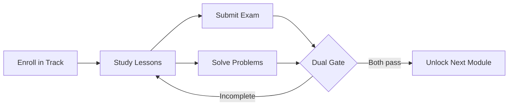

<div align="center">
  <picture>
    <source media="(prefers-color-scheme: dark)" srcset=".github/assets/banner-dark.svg">
    
  </picture>
</div>

<div align="center">

[](https://github.com/Tawjjeh/TalebElm/actions/workflows/ci.yml)
[](LICENSE)
[](https://dotnet.microsoft.com/download)
[](https://github.com/Tawjjeh/TalebElm/discussions)

[How it works](#how-it-works) · [What's inside](#whats-inside) · [Status](#status) · [Quick start](#quick-start) · [Architecture](#architecture) · [Documentation](#documentation) · [Contributing](#contributing)

</div>

---

**Learn software engineering. Earn every step.**

TalebElm is an open-source learning platform for software engineering built around ordered tracks, real exams, and verified practice that must be completed before the next step unlocks.

## How it works

- Enroll in an ordered Track and study its Lessons.
- At the end of each Module, take a server-graded conceptual Exam.
- Solve assigned practice problems verified automatically via the Codeforces API and GitHub Actions.
- When both the exam and problem gates pass, the next Module unlocks forward-only.
- Track completion requires passing every Module and completing all Capstone milestones.



## Progression unlock rule

A module unlocks its successor if and only if both its exam gate and its problem gate hold, evaluated inside an atomic transaction as specified in the [business rules](docs/business/BUSINESS_RULES.md#6-progress-tracking-unlock) and [architectural decisions](docs/OPEN_DECISIONS.md):

```text
examGate    = !hasExam || PassedExam
problemGate = !hasRequiredProblems || CompletedRequiredProblems
unlockNext  = (hasExam || hasRequiredProblems) && examGate && problemGate && nextModuleExists
```

Progress is forward-only and sticky: passing an exam or completing required problems cannot be undone by a later attempt.

## What's inside

- **Guided tracks:** Ordered Tracks, Modules, and Lessons with structured explanations and curated references, requiring explicit enrollment.
- **Server-graded exams:** Multiple-choice assessments graded strictly on the server against hidden answer keys, recording the latest score and preserving passes permanently.
- **Verified practice:** Algorithmic solutions checked through the public Codeforces API and hands-on repository tasks verified against GitHub Actions runs and commit SHAs.
- **Open resource hub:** A public, searchable index organized by language, technology, and topic that visitors can browse anonymously without an account.

## Status

All current work is tracked under six MVP milestones:

| Milestone | Scope | In MVP | Open | Closed |
|---|---|---|---|---|
| [M0 Foundations](https://github.com/Tawjjeh/TalebElm/milestone/1) | DI baseline, error mapping, cancellation tokens, CI health | Yes | 6 | 18 |
| [M1 Identity](https://github.com/Tawjjeh/TalebElm/milestone/2) | Registration, login, PBKDF2 hashing, signed JWT issuance, authorization policies | Yes | 6 | 1 |
| [M2 Learning flow](https://github.com/Tawjjeh/TalebElm/milestone/3) | Tracks, Modules, Lessons, Exams, Progress, server-side grading, sticky unlocking | Yes | 19 | 8 |
| [M3 Automated Verification](https://github.com/Tawjjeh/TalebElm/milestone/4) | External accounts, Codeforces solve checks, GitHub OAuth, task SHA integrity, dual-gate unlock | Yes | 26 | 8 |
| [M4 Public Resource Hub](https://github.com/Tawjjeh/TalebElm/milestone/5) | Technology tree, Resource persistence, anonymous search and filters, admin curation, link checker | Yes | 8 | 2 |
| [M5 Capstone Projects](https://github.com/Tawjjeh/TalebElm/milestone/6) | Capstone persistence, ordered milestone verification via GitHub tasks, derived Track completion | Yes | 4 | 3 |

## Quick start

### Prerequisites

- [.NET 10 SDK](https://dotnet.microsoft.com/download) (or .NET 11 preview; runtime roll-forward is enabled).
- Git.
- Python 3 (required for documentation audits).

### Build, test, and run

```bash
git clone https://github.com/Tawjjeh/TalebElm.git
cd TalebElm
dotnet restore TalebElm.slnx
dotnet build TalebElm.slnx
dotnet test TalebElm.slnx
dotnet run --project src/TalebElm.Api
```

Verify the health check in another terminal:

```bash
curl http://localhost:5236/api/health
# healthy
```

In development, the API seeds sample track data and runs against SQLite. Swagger UI is available at <http://localhost:5236/swagger>.

Before committing documentation changes, run the audit script:

```bash
python3 scripts/check-docs.py
```

## Architecture

Dependencies point strictly inward. Outer layers depend on inner layers; inner layers have zero knowledge of outer layers.

| Layer | Project | Responsibilities | May depend on |
|---|---|---|---|
| **Api** | `src/TalebElm.Api` | HTTP controllers, middleware, exception handling, Swagger, DI host | Infrastructure, Application, Domain |
| **Infrastructure** | `src/TalebElm.Infrastructure` | EF Core `AppDbContext`, migrations, configurations, repositories, external HTTP clients | Application, Domain |
| **Application** | `src/TalebElm.Application` | DTOs, service implementations, FluentValidation validators, external client interfaces | Domain |
| **Domain** | `src/TalebElm.Domain` | Entities, enums, domain exceptions, repository contracts, `IUnitOfWork` | *None (zero dependencies)* |

See [`ARCHITECTURE.md`](ARCHITECTURE.md) for detailed layering rules and coding conventions.

## Documentation

| Guide | Content |
|---|---|
| [`docs/README.md`](docs/README.md) | Central documentation directory and reading order |
| [`docs/FEATURE_INDEX.md`](docs/FEATURE_INDEX.md) | Current implementation state versus MVP target per feature |
| [`docs/business/ROADMAP.md`](docs/business/ROADMAP.md) | Definitive MVP boundaries, milestone exit criteria, and post-MVP directions |
| [`docs/business/BUSINESS_RULES.md`](docs/business/BUSINESS_RULES.md) | Binding product rules with implementation status |
| [`docs/OPEN_DECISIONS.md`](docs/OPEN_DECISIONS.md) | Architectural and product decisions (Decisions 1 through 40) |
| [`docs/LOCAL_SETUP.md`](docs/LOCAL_SETUP.md) | Local database setup, connection strings, and EF Core migrations |

## Roadmap

The MVP scope is defined in [`docs/business/ROADMAP.md`](docs/business/ROADMAP.md) with explicit exit criteria. Community input on post-MVP tracks, platforms, and tool additions is welcome in [Discussions](https://github.com/Tawjjeh/TalebElm/discussions).

## Contributing

We welcome open-source contributions. To maintain clean architecture and prevent overlapping effort:

1. **Pick an issue:** Find an open issue with `help wanted`, or `good first issue` if you are new: [available issues](https://github.com/Tawjjeh/TalebElm/issues?q=is%3Aissue+is%3Aopen+label%3A%22help+wanted%22+no%3Aassignee).
2. **Get assigned:** Comment on the issue with your approach. Work begins only after an owner assigns the issue to you (unassigned pull requests are closed kindly per the green-light rule).
3. **Keep it small:** Make the smallest clean change with automated tests proving the behavior (about 200 lines).
4. **Open a pull request:** Reference the issue with `Closes #N` and ensure build, tests, and doc checks pass.

Read [`CONTRIBUTING.md`](CONTRIBUTING.md) for full guidelines and safety rules.

## License and security

TalebElm is licensed under the [GNU General Public License v3.0](LICENSE). Brand assets in `.github/assets/` are governed by their respective licenses (see [`.github/assets/README.md`](.github/assets/README.md)).

Report security vulnerabilities privately following [`SECURITY.md`](SECURITY.md). Community interactions are governed by our [`CODE_OF_CONDUCT.md`](CODE_OF_CONDUCT.md).
