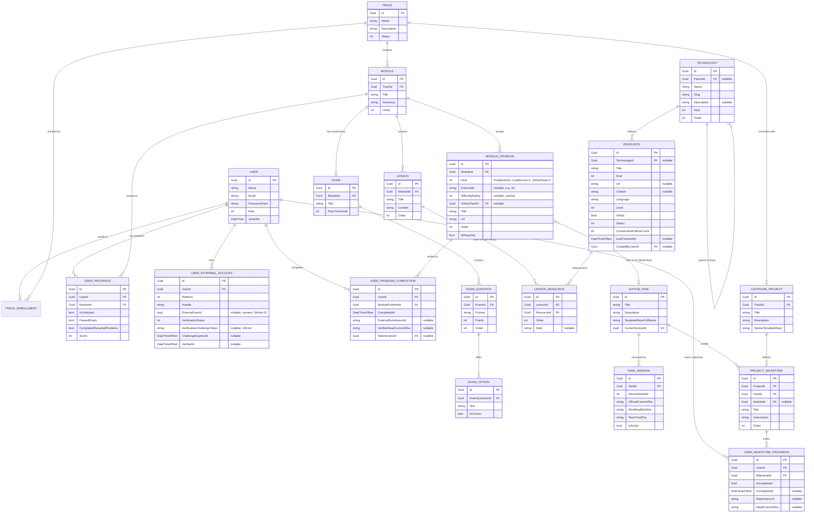

# TalebElm Data Model: Current and Proposed

This document distinguishes Domain entities that exist in code from the relational rules the MVP still needs. `AppDbContext` applies a configuration for every current entity, and the committed migrations reflect that model.

## 1. Current Domain Entities

| Entity | Properties | Current constraints/status |
|---|---|---|
| User | `Id: Guid`, `CreatedAt: DateTimeOffset`, `Name: string`, `Email: string`, `PasswordHash: string`, `Role: UserRole`, `JoinedAt: DateTime` | `Name` ≤ 100, `Email` ≤ 256 and unique `NOCASE`, `PasswordHash` required/non-blank, `Role` defaults to `Student`. Navigation: `TrackEnrollments`, `UserProgress`. |
| Track | `Id`, `CreatedAt`, `Name`, `Description`, `Status: TrackStatus` | `Name` ≤ 150, `Description` ≤ 1000, non-empty checks. `TrackStatus`: Draft=0, Published=1, Archived=2. New Tracks default to `Draft`. Navigation: `Modules`, `TrackEnrollments`. |
| Module | `Id`, `CreatedAt`, `Title`, `Summary`, `Order: int`, `TrackId: Guid` | `Title` ≤ 150, `Summary` ≤ 500, non-empty title, `Order > 0`. `UNIQUE(TrackId, Order)` is implemented (see §5). Navigation: `Track`, `Lessons`, `Exam`. |
| Lesson | `Id`, `CreatedAt`, `Title`, `Content`, `Order: int`, `ModuleId: Guid` | `Title` ≤ 150, `Content` required, `Order > 0`. `UNIQUE(ModuleId, Order)` is implemented. No `LessonType` property; the enum exists separately. Navigation: `Module`; resources are queried through `LessonResource`. |
| LessonResource | `Id`, `CreatedAt`, `LessonId: Guid`, `Title: string`, `Kind: LessonResourceKind`, `Url: string?`, `Citation: string?`, `Order: int` | `Title` ≤ 200, `Order > 0`, required `Lesson` FK with `Restrict`. URL/citation validation and unique `(LessonId, Order)` are target work (see #283). |
| Exam | `Id`, `CreatedAt`, `Title`, `PassThreshold: int`, `ModuleId: Guid` | `Title` ≤ 150, `UNIQUE(ModuleId)` implemented. `HasPassed(score)` returns `score >= PassThreshold`. No question model yet. |
| TrackEnrollment | `Id`, `CreatedAt`, `UserId: Guid`, `TrackId: Guid`, `EnrolledAt: DateTimeOffset` | `UNIQUE(UserId, TrackId)` implemented; both FKs use `Restrict`. Enrollment workflow is target behavior. |
| UserProgress | `Id`, `CreatedAt`, `UserId: Guid`, `ModuleId: Guid`, `IsUnlocked: bool`, `PassedExam: bool`, `Score: int` | Unique index exists on `(UserId, ModuleId)`; score check is 0–100. `Score` stores the **latest** attempt score; `PassedExam` is sticky (see §4). |

`Id` and `CreatedAt` are inherited from `BaseEntity`.

## 2. Relationships

### Intended learning relationships

- Track 1 → many Modules, ordered by `Module.Order`.
- Module 1 → many Lessons, ordered by `Lesson.Order`.
- Module 0/1 → Exam (at most one exam per Module; unique index implemented).
- User 1 → many UserProgress rows.
- Module 1 → many UserProgress rows.
- User 1 → many TrackEnrollments; Track 1 → many TrackEnrollments.
- Lesson 1 → many LessonResources (queried directly; no reverse collection on Lesson).

### Current EF Core mapping status

- Configurations exist for `User`, `Track`, `Module`, `Lesson`, `Exam`, `UserProgress`, `TrackEnrollment`, and `LessonResource`; required relationships use explicit foreign keys with `DeleteBehavior.Restrict` and the unique indexes in §5.
- `UserProgressConfiguration` maps the unique `(UserId, ModuleId)` index; `TrackEnrollmentConfiguration` maps the unique `(UserId, TrackId)` index.
- Navigation properties (`Track.Modules`/`TrackEnrollments`, `Module.Track`/`Lessons`/`Exam`, `Lesson.Module`, `Exam.Module`, `UserProgress.User`/`Module`, `TrackEnrollment.User`/`Track`, `LessonResource.Lesson`) are implemented. `Lesson.Resources` is intentionally not defined; resources are queried through `LessonResource`.
- `ExamQuestion`/`ExamOption` remain proposed; see §3.

## 3. MVP Entities: Persistence Status

### TrackEnrollment (Implemented)

Keep Track enrollment distinct from per-Module progress. Fields: `Id`, `UserId`, `TrackId`, `EnrolledAt`; unique `(UserId, TrackId)`. The entity, configuration, repository, and migration exist. The enrollment workflow (including creation of the first `UserProgress` row) is target behavior.

### LessonResource (Implemented)

Allow one Lesson to cite multiple learning sources. Fields: `Id`, `LessonId`, `Title`, `Kind`, `Url?`, `Citation?`, and `Order`. The entity, configuration, repository, and migration exist. URL/citation validation and authoring workflow remain target behavior.

### ExamQuestion and ExamOption (Proposed)

For the first exam format, use ordered multiple-choice questions. `ExamQuestion` belongs to Exam and stores Prompt, Order, and Points. `ExamOption` belongs to a question and stores learner-visible Text plus server-only `IsCorrect`. Never return `IsCorrect` in a learner response.

## 4. Target Progression Transaction

1. Create a TrackEnrollment for the authenticated User and selected Track.
2. Create UserProgress for the lowest-Order Module with `IsUnlocked = true`.
3. Compute the score on the server from the selected answers (the MVP does not store attempt history).
4. Update the current Module's progress with the latest score; set `PassedExam = true` on a pass and never reset it on a later failed retake.
5. On pass, unlock only the next Module in the same Track; on failure, leave later Modules locked.
6. Commit the result and progress changes in one UnitOfWork operation.

## 5. MVP Integrity Rules (binding)

These rules close design-review questions Q2–Q3, Q5, Q7–Q12. They are binding for implementation and tests.

### 5.1 Exam scoring, retries, and pass validation

- **Score scale:** `Score` is an integer `0–100`. `Exam.PassThreshold` is an integer `1–100` in the same scale. `Exam.HasPassed(score)` is `score >= PassThreshold`. The database check `CK_Exams_PassThreshold_Range` enforces `1–100`.
- **Server-side grading only:** the score is computed by the Application service from server-side answer keys. A client-supplied score is never trusted.
- **Retries:** unlimited attempts, no cooldown in the MVP.
- **Latest-wins for `Score`, sticky-wins for `PassedExam`:** each submission overwrites `UserProgress.Score` with the latest attempt score, but `PassedExam`, once `true`, is never reset to `false` by a later failed retake. A pass is permanent.
- **No attempt history in MVP:** only the aggregate outcome lives in `UserProgress`. Do not add `ExamAttempt` / `StudentAnswer` tables until history or analytics is an approved requirement.
- **Modules without exams:** a Module MAY exist without an Exam in the MVP. A Module with no Exam never sets `PassedExam`; progression past it is defined by the enrollment/progression spec (explicit unlock rule), not by an implicit pass.

### 5.2 Unique ordering constraints

The current database indexes are enforced; duplicate-prevention in Application is target behavior where noted:

| Table | Constraint | Meaning |
|---|---|---|
| `Module` | `UNIQUE(TrackId, Order)` | No two Modules share an `Order` within one Track. |
| `Lesson` | `UNIQUE(ModuleId, Order)` | No two Lessons share an `Order` within one Module. |
| `UserProgress` | `UNIQUE(UserId, ModuleId)` | Exactly one progress row per learner + Module. |
| `Exam` | `UNIQUE(ModuleId)` | At most one Exam per Module. |
| `TrackEnrollment` | `UNIQUE(UserId, TrackId)` | One enrollment per learner + Track. |
| `LessonResource` | `UNIQUE(LessonId, Order)` (target) | No two resources share an `Order` within one Lesson. The index is not in the current migration; tracked by #283. |

Reordering or inserting in the middle must shift sibling `Order` values inside the same `UnitOfWork` transaction so the constraint never observes a duplicate. Reordering a `Published` Track after learners have started is discouraged: existing `UserProgress` rows stay keyed to Modules (by `ModuleId`, never by `Order`), but product must confirm the unlock impact before approving the change.

### 5.3 Module lifecycle: unlock, re-lock, enrollment

- **Initial progress:** enrollment creates the `TrackEnrollment` row and exactly one `UserProgress` row — for the lowest-`Order` Module — with `IsUnlocked = true`. No other rows are pre-created.
- **Forward-only unlock:** a pass unlocks only the next Module in the same Track (creates its `UserProgress` row with `IsUnlocked = true` if absent). A fail records the score and unlocks nothing. The final Module has no next Module.
- **No silent re-lock:** a Module that is unlocked is never automatically re-locked (not by a later failed retake, not by reordering). `IsUnlocked`, like `PassedExam`, is sticky.
- **Manual unlock:** an `Admin` may explicitly unlock any Module for a learner (support/admin operation). The operation creates the `UserProgress` row if missing and sets `IsUnlocked = true` without altering `Score` / `PassedExam`. Every manual unlock is an auditable admin action.
- **Enrollment:** learners must explicitly enroll; `Published` Tracks are **not** auto-available. Duplicate enrollment returns `409 Conflict`. Enrolling in a Track with zero Modules is rejected with no partial rows. There is no un-enroll in the MVP.

### 5.4 Delete policy: `Restrict`, never silent cascade

All learning-path foreign keys use `DeleteBehavior.Restrict`. There is no soft delete in the MVP and no cascading delete of learner data. `UnitOfWork.SaveChangesAsync` translates a dependent-delete failure, like a unique-index violation, into `ConflictException`, which the API returns as `409`.

| Target | Rule |
|---|---|
| `Track` | Blocked (`409`) while any `Module`, `TrackEnrollment`, or `UserProgress` (via its Modules) references it. Archive (`Status = Archived`) instead of deleting a shipped Track. |
| `Module` | Blocked (`409`) while any `Lesson`, `Exam`, or `UserProgress` references it. Deleting a Module requires first removing its Lessons/Exam and resolving learner rows by product decision; then re-sequence surviving siblings to contiguous `Order` (`1, 2, 3, …`) in the same transaction. |
| `Lesson` | Blocked (`409`) while learner-facing linkage depends on it (resources, progress views). After deletion, re-sequence surviving Lessons in the Module contiguously in the same transaction. |
| `Exam` | Deleting an Exam is allowed only when no grading depends on it; it never deletes the parent Module or learner `UserProgress` rows. |
| `User` | Learner history is preserved: never cascade-delete `TrackEnrollment` / `UserProgress` rows when a user is removed. Account removal follows the auth/identity retention policy. |

---

## 6. Proposed Target Architecture ERD (Three Pillars)

> **Status discipline:** This section is **Proposed / Target**. Entities below expand the current domain to support the three product pillars (Resource Hub, verified problems, and capstone projects). Current entities in §1 remain untouched until corresponding migrations land.

## Decision 32–36 Proposed additions
- `UserProgress.CompletedRequiredProblems`, sticky boolean, default false.
- Filtered unique indexes for external accounts (`Verified` only).
- `ModuleProblem.GitHubTaskId` nullable with CHECK by Kind.
- `TaskVersionStatus` enum (Active/Deprecated/Retired) and filtered unique Active version.
- Capstone: `CapstoneProject.TaskId` unique, `ProjectMilestone.WorkflowJobName` unique per project.
- Hub: two filtered unique indexes per nullable parent for slug and order.
