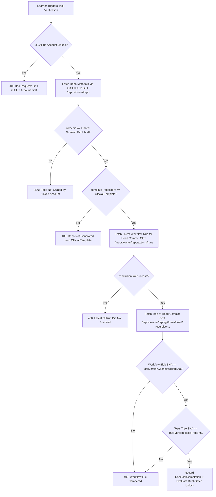

# Task Template Specification (CodeCrafters-Style Automated Verification)

> **Status discipline:** This specification is **Target** (decided for implementation in Phase 3).
> Defines the structure, versioning, integrity verification, and authoring standards for practical `GitHubTask` templates under the project organization.

---

## 1. Overview & Guiding Principle

To maintain **Zero Manual Gating**, framework and real-world software engineering skills cannot rely on manual code reviews or self-reporting. Instead, TalebElm adopts an automated, repository-based assessment model inspired by CodeCrafters:

1. Each practical task has an official public starter template repository hosted under the project organization (`Tawjjeh/task-<slug>-template`).
2. The template contains starter code, instructions, a comprehensive test suite, and a locked GitHub Actions workflow.
3. The learner generates a public repository from the template, writes code to satisfy the tests, and pushes commits to their default branch.
4. The platform verifies test pass status and cryptographic file integrity through the GitHub REST API.

---

## 2. Template Repository Structure

Every official task template repository must adhere to the following directory layout:

```text
task-<slug>-template/
├── .github/
│   └── workflows/
│       └── test.yml           <-- Official CI workflow (LOCKED)
├── src/                       <-- Starter code / implementation skeleton
│   └── ...                    <-- Learner modifies files in this directory
├── tests/                     <-- Test suite asserting task requirements (LOCKED)
│   └── ...                    <-- Learner must NOT tamper with this directory
├── .gitignore
└── README.md                  <-- Task description, requirements, and local run guide
```

### 2.1 The Workflow File (`.github/workflows/test.yml`)
- Must run on `ubuntu-latest`.
- Must trigger on `push` to the default branch (`main` or `master`) and `pull_request`.
- Must restore dependencies, build the solution, and execute the test runner (e.g., `dotnet test`).
- Must exit with code 0 on test pass; non-zero on test failure.
- Must not upload secrets or depend on private self-hosted runners.

### 2.2 The Tests Directory (`tests/`)
- Contains test cases covering every requirement of the task.
- Must cleanly separate public interfaces from implementation details so learners can design their internal code freely.
- Must execute deterministically without external network access or timing flakes.

---

## 3. Cryptographic Integrity & Versioning

Because the GitHub Actions workflow executes inside the learner's own repository, a learner could theoretically modify the test suite or workflow file to trivially report success (e.g., changing tests to `Assert.True(true)` or changing the workflow to `exit 0`).

To protect against this, TalebElm enforces **Git Tree/Blob SHA Integrity Verification**.

### 3.1 The `TaskVersion` Entity
When a task is authored or updated, maintainers release an official `TaskVersion`:

| Field | Type | Description |
|---|---|---|
| `Id` | `Guid` | Primary key |
| `TaskId` | `Guid` | FK to `GitHubTask` |
| `VersionNumber` | `int` | Monotonically increasing version (1, 2, 3...) |
| `TemplateRepoFullName` | `string` | e.g., `Tawjjeh/task-aspnet-middleware-template` |
| `OfficialCommitSha` | `string` | 40-character Git commit hash of the released template tag |
| `WorkflowBlobSha` | `string` | 40-character Git blob SHA of `.github/workflows/test.yml` |
| `TestsTreeSha` | `string` | 40-character Git tree SHA of the `tests/` directory |
| `IsActive` | `bool` | Whether new learners are assigned this version |

### 3.2 Generating Official SHAs
Maintainers compute the official SHAs directly using standard Git plumbing commands:

```bash
# 1. Compute Git Blob SHA of the workflow file:
git hash-object .github/workflows/test.yml
# Output: e.g., 3b18e512dba79e4c8300dd08aeb37f8e728b8dad

# 2. Compute Git Tree SHA of the tests directory:
git rev-parse HEAD:tests
# Output: e.g., 7a82b3d681c4e8574d6199a5e425026b9a89c251
```

These two 40-character hexadecimal strings are stored in `TaskVersion`.

---

## 4. Platform Verification Algorithm

When a learner triggers task verification (`POST /api/tasks/{taskId}/verify`), the platform executes the following check sequence:



1. **Identity Match:** Ensure `repository.owner.id` matches the learner's immutable numeric `GitHubUserId` stored during OAuth linking.
2. **Template Provenance:** Ensure `repository.template_repository.full_name` matches `TaskVersion.TemplateRepoFullName`.
3. **CI Run Success:** Retrieve workflow runs for the head commit on the default branch. The latest run for `.github/workflows/test.yml` must have `status == "completed"` and `conclusion == "success"`.
4. **Integrity Match:** Inspect the Git tree of the head commit:
   - The blob SHA of `.github/workflows/test.yml` must strictly match `TaskVersion.WorkflowBlobSha`.
   - The tree SHA of the `tests/` directory must strictly match `TaskVersion.TestsTreeSha`.
5. **Completion Record:** If and only if all checks pass, record completion and trigger the Module unlock evaluation inside a single `UnitOfWork` transaction.

---

## 5. Authoring Guide for Maintainers

1. **Create Template Repository:** Create a new public repository under `Tawjjeh/` named `task-<slug>-template`.
2. **Check "Template repository":** In repository settings on GitHub, enable the **"Template repository"** checkbox so learners can generate repos from it.
3. **Implement Skeleton and Tests:**
   - Write clean starter code in `src/`.
   - Write thorough unit/integration tests in `tests/`.
   - Add `.github/workflows/test.yml` and verify that the workflow runs and initially fails (red) on the starter code.
4. **Produce Release Tag:** Commit, tag as `v1.0.0`, and push.
5. **Extract SHAs:** Run `git hash-object .github/workflows/test.yml` and `git rev-parse HEAD:tests`.
6. **Register Task in TalebElm:** Admin inserts the `GitHubTask` and `TaskVersion` record with the extracted SHAs and template repository name.

## Decision 35 alignment
Use `UserProblemCompletion` terminology and `TaskVersionStatus`. Job-level GitHub verification requires all jobs for plain tasks and the named job for milestones. Templates must avoid mutable root build files or include them in the integrity set.
