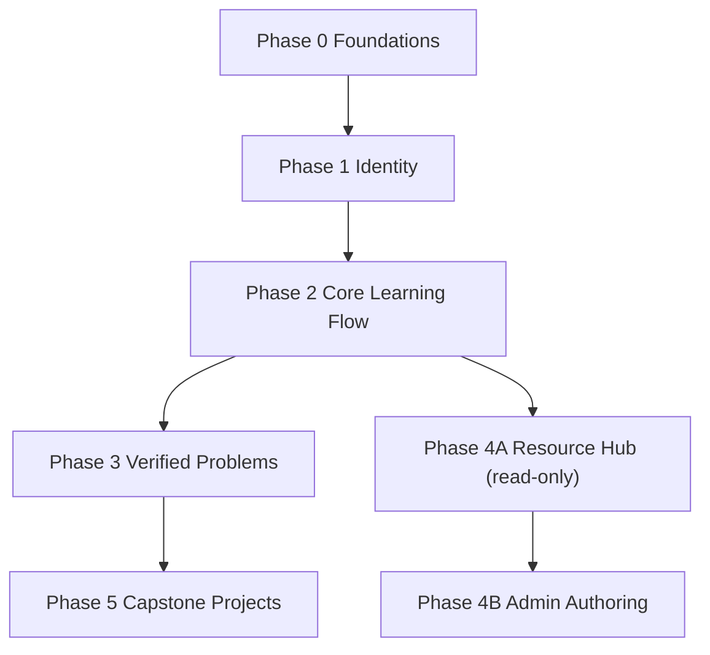

# TalebElm Product Roadmap

> **Status discipline:** Every phase and deliverable is marked **Implemented** (present in code today), **Target** (decided for MVP rollout), or **Proposed** (design pending team decision).
> All backend implementation follows Clean Architecture conventions described in [`ARCHITECTURE.md`](../../ARCHITECTURE.md).

---

## MVP boundary

TalebElm is an open-source .NET 10 Clean Architecture learning-platform backend that enforces genuine, verified progress through zero manual gating.

The MVP covers the full learner and content-authoring lifecycle:

> register or log in → browse and enroll in a published Track → study its Lessons → submit a server-graded Exam → complete the required Codeforces and GitHub practice problems → unlock the next Module → complete the Track Capstone project → browse or curate the public Resource Hub.

### Scope boundaries and rationale

| Area | In MVP | Out of MVP | Rationale |
|---|---|---|---|
| **Identity & Access** | Email + PBKDF2 password registration, login, signed JWT bearer tokens, `StudentOnly` and `AdminOnly` authorization policies. | Social sign-in, MFA, password reset emails, user profile pictures. | Secure email/password authentication is sufficient for learner progress tracking and policy enforcement; secondary auth features add integration surface without improving core learning flow. |
| **Learning Path Delivery** | Hierarchical Track → Module → Lesson delivery, ordered display, published-only visibility, explicit enrollment (`TrackEnrollment`). | Dynamic prerequisite graphs, multi-track branching, non-linear module paths, course recommendations. | Linear ordered tracks provide clear, unambiguous progression without graph scheduling complexity. |
| **Assessment & Grading** | Multiple-choice Exams graded strictly server-side from stored answer keys, unlimited retakes without cooldown, latest score recorded, sticky `PassedExam`. | Timed exams, cooldown windows, essay/free-form grading, exam attempt history tables. | Unlimited retakes with sticky pass encourage mastery; storing full historical attempts adds data volume without changing current progression state. |
| **Practice Verification** | 100% automated verification: Codeforces algorithmic solves via public API (`user.status`) + practical framework tasks verified via GitHub REST API (template provenance, default-branch workflow CI success, Git blob/tree SHA matches against `TaskVersion`). | In-browser code editor/compiler, live contest hosting, platform-hosted test runner sandboxes. | Real software engineers work in local IDEs, git repositories, and specialized judges; hosting compilers or sandboxes creates high operational cost and unnecessary security attack surfaces. |
| **Progression Gating** | Dual-gated sticky forward-only module unlock: next Module unlocks only when both exam passed (if present) and required practice problems solved (if present). Admin manual unlock for support. | Manual checklist approvals, peer reviews as blocking gates, time-delayed module drip, automatic re-locking. | Zero manual gating ensures consistent progression standards for every learner; sticky unlock guarantees achieved progress is never lost. |
| **Resource Hub** | Anonymous 3-click hierarchy (`Language` → `Framework/Technology` → `Topic`), keyword search, filters, Admin curation, scheduled SSRF-safe link health checker. | Unmoderated community submissions, upvoting/ranking algorithms, user bookmark collections. | Curated high-signal index provides immediate utility without account friction; open unmoderated submissions risk spam and broken links before curation tooling matures. |
| **Capstone Projects** | Cumulative portfolio project per Track across ordered `ProjectMilestone`s verified automatically via GitHub tasks; derived Track completion. | Human mentor project reviews, issued PDF/blockchain certificates, multi-student team projects. | Automated milestone verification proves hands-on competence without subjective grading bottlenecks; certificates remain out of scope for the MVP backend. |
| **Commercial Features** | 100% Free and Open Source under GPL-3.0. | Paid tiers, subscriptions, paywalls, checkout, payment gateway integrations. | TalebElm is built as open public educational infrastructure. |

### Verifiable exit criteria

The MVP is complete when all of the following conditions are satisfied:

1. **Milestones closed:** All 6 milestones ([M0](https://github.com/Tawjjeh/TalebElm/milestone/1) through [M5](https://github.com/Tawjjeh/TalebElm/milestone/6)) have all their assigned issues implemented and closed on GitHub.
2. **Clean build:** `dotnet build TalebElm.slnx` compiles with 0 warnings and 0 errors in both Debug and Release configurations.
3. **Comprehensive test suite:** `dotnet test TalebElm.slnx` passes with 0 failures and 0 skipped tests, covering unit tests, integration tests, DI full-graph resolution, and blank-database migration chains.
4. **Documentation audit:** `python3 scripts/check-docs.py` passes across all public documentation files with zero broken links, invalid anchors, or table column mismatches.
5. **End-to-end learning loop verified:** A complete automated end-to-end integration test proves that a learner registers, logs in, enrolls in a published track, reads lessons, submits a passing exam, completes required practice problems, unlocks the subsequent module via the dual gate, completes all capstone milestones, and attains derived track completion with zero manual intervention.

### Milestone mapping

| Milestone | Scope | Done when |
|---|---|---|
| [**M0 Foundations**](https://github.com/Tawjjeh/TalebElm/milestone/1) | DI baseline, validation errors, content guards, cancellation tokens, logging, API wiring, CI health | The API starts cleanly, returns real responses, and the build, tests, and blank-database migration check are green. |
| [**M1 Identity**](https://github.com/Tawjjeh/TalebElm/milestone/2) | Registration, login, JWT, `StudentOnly` / `AdminOnly`, users API, login throttling | A learner can register, log in, and reach a protected route; 401/403/409 behave correctly. |
| [**M2 Learning flow**](https://github.com/Tawjjeh/TalebElm/milestone/3) | Tracks, Modules, Lessons, Exams, Progress, server-side grading, sticky unlocking, lesson type and authoring fields | The full study loop works and a pass unlocks only the next Module. |
| [**M3 Automated Verification**](https://github.com/Tawjjeh/TalebElm/milestone/4) | External accounts, Codeforces handle and solve verification, GitHub OAuth, `GitHubTask` and `TaskVersion` SHA integrity checks, `ModuleProblem`, `UserProblemCompletion`, dual-gate unlock | Required Codeforces problems and GitHub tasks are verified automatically and the dual gate blocks or unlocks correctly. |
| [**M4 Public Resource Hub**](https://github.com/Tawjjeh/TalebElm/milestone/5) | Technology tree, `Resource` persistence and repositories, anonymous browse/search/filters, Admin curation, safe link-health checker with SSRF rules, shared `LessonResource` migration | Visitors browse and filter resources without logging in, broken links are flagged automatically, and Admins curate unified resources. |
| [**M5 Capstone Projects**](https://github.com/Tawjjeh/TalebElm/milestone/6) | `CapstoneProject` and `ProjectMilestone` persistence, milestone verification via GitHub tasks, derived Track completion, learner Capstone endpoints | Learners complete ordered capstone milestones automatically and Track completion derives cleanly with zero manual gating. |

The milestone names above match the GitHub milestones (`M0` through `M5`). Every open issue belongs to one of these six MVP milestones.

### Progression unlock rule

A Module unlocks its successor if and only if both its exam gate and its problem gate hold, evaluated inside an atomic UnitOfWork transaction as specified in [Decision 32](../OPEN_DECISIONS.md) and [Business Rule P-2](BUSINESS_RULES.md#6-progress-tracking-unlock).

---

## Roadmap Overview

> Phase 4A runs in parallel with Phases 1 to 3 and has zero direct dependency.
Phase 0 includes the DI baseline, content guards, validation errors, cancellation tokens, migration-chain tests, and API wiring. Phase 3 includes the `CompletedRequiredProblems` migration and the `ProgressResponse` counts.

## Phase 0: Foundations & Architecture Baseline

- **Status:** Target (In Progress)
- **Goal:** Establish a rock-solid, fully testable Clean Architecture baseline with zero runtime DI ambiguities, clean controller delegations, and corrected database integrity constraints.
- **Scope:**
  - Consolidate Dependency Injection registrations across `AddApplication()`, `AddInfrastructure()`, and `Program.cs` (Issue #274).
  - Add a comprehensive full-graph DI resolution test (`DependencyResolutionTests`) ensuring all services, repositories, validators, and `IUnitOfWork` resolve without runtime exceptions.
  - Wire placeholder API controllers (`TracksController`, `ModulesController`, `LessonsController`, `ExamsController`) to call existing application services rather than throwing `NotImplementedException`.
  - Fix PassThreshold constraint in database from `0–100` to `1–100` to eliminate bypass vulnerability (#326 resolved).
  - Standardize error handling and ProblemDetails mapping (#321 resolved: FluentValidation failures return field-keyed `errors`; domain `ValidationException` keeps a single `detail`).
- **Dependencies:** None.
- **Exit Criteria:**
  - `dotnet run --project src/TalebElm.Api` boots cleanly with no DI configuration warnings or exceptions.
  - Full-graph DI integration test passes in Release and Debug modes.
  - Existing endpoints return valid JSON or correct HTTP status codes instead of `501 Not Implemented`.
  - `BlankDatabaseMigrationTests` stays green, proving a blank database reaches the latest schema.
- **Issue Areas:** `architecture`, `layer:infrastructure`, `layer:application`, `layer:api`, `database`.

---

## Phase 1: Identity & Authentication

- **Status:** Target
- **Goal:** Provide secure, standards-compliant user registration, authentication, JWT token issuance, and role-based policy enforcement.
- **Scope:**
  - Registration endpoint (`POST /api/auth/register`) validating email uniqueness case-insensitively and password complexity.
  - Authentication endpoint (`POST /api/auth/login`) issuing signed JWT bearer tokens with `UserId` and `Role` claims.
  - Password hashing utilizing the existing PBKDF2 `PasswordHasher` (`Implemented`).
  - Configure ASP.NET Core Authentication and Authorization middleware in `Program.cs`.
  - Define and test authorization policies: `StudentOnly` (`Student`, with `Admin` override) and `AdminOnly`.
  - Current-user context resolution: extract `UserId` from `ClaimsPrincipal` in controllers and pass explicitly to Application services.
- **Dependencies:** Phase 0 (DI and controller baseline).
- **Exit Criteria:**
  - Unauthenticated requests to protected endpoints return `401 Unauthorized`.
  - Forbidden actions (e.g., student calling admin endpoints) return `403 Forbidden`.
  - Registration rejects duplicate emails with `409 Conflict`.
  - Login returns signed JWTs with verified claims; passwords are never logged or stored in plaintext.
- **Issue Areas:** `feature:auth`, `layer:application`, `layer:api`, `security`.

---

## Phase 2: Core Learning Flow (Exams & Progression)

- **Status:** Target
- **Goal:** Complete the end-to-end Track study loop: track enrollment, lesson delivery, multiple-choice question storage, server-side grading, and sticky forward-only module unlocking.
- **Scope:**
  - Track enrollment workflow (`POST /api/tracks/{trackId}/enrollment`): creates `TrackEnrollment` and unlocks the first Module (`IsUnlocked = true`). Rejects duplicates with `409 Conflict`.
  - Exam question entities (`ExamQuestion`, `ExamOption`): multiple-choice schema, order, points, and server-only `IsCorrect`.
  - Server-side exam grading (`POST /api/exams/{id}/submit`): receives submitted answer IDs, computes score from stored answer key, updates `UserProgress` (latest score wins, `PassedExam` is sticky).
  - Progression gating: enforce `403 Forbidden` when an unauthorized or locked module/lesson/exam is accessed.
  - User progress query endpoints (`GET /api/progress/me`, `GET /api/progress/me/tracks/{trackId}`).
- **Dependencies:** Phase 0, Phase 1.
- **Exit Criteria:**
  - Learner can enroll in a published track and automatically unlock Module 1.
  - Learner answers exam questions; score is graded strictly on the server (client score input removed).
  - Passing score (`score >= PassThreshold`) sets `PassedExam = true` and unlocks the next Module in the Track.
  - Retaking a passed exam with a lower score never clears `PassedExam` (sticky).
  - Locked modules return `403 Forbidden`, never `404 Not Found`.
- **Issue Areas:** `feature:tracks`, `feature:exams`, `layer:domain`, `layer:application`, `layer:infrastructure`, `layer:api`.

---

## Phase 3: External Problems & Automated Verification

- **Status:** Target
- **Goal:** Integrate external coding problem platforms (Codeforces) and practical framework tasks (automated GitHub tasks), enforcing zero manual gating and dual-gated progression.
- **Scope:**
  - `ProblemKind` enum: `CodeforcesProblem` and `GitHubTask`, implemented behind `IProblemVerifier`.
  - `UserExternalAccount` entity & repository: stores Codeforces handle and GitHub OAuth numeric ID (`ExternalNumericId`).
  - Codeforces handle verification: server issues 128-bit single-use token; learner pastes into Codeforces profile; platform verifies via public `user.info` API.
  - Codeforces solve verification: queries public `user.status` for `verdict == "OK"` matching `contestId` and problem `index`. All-time accepted solves count. Enforces 60s per-user debouncing.
  - Automated GitHub tasks (CodeCrafters-style): official starter template repositories (`Tawjjeh/task-<slug>-template`), GitHub REST API client (`IGitHubClient`), checking repository ownership, template provenance, latest workflow run success, and cryptographic blob/tree SHA matches against `TaskVersion`.
  - Unified `UserProblemCompletion` entity.
  - Dual-gated atomic progression: Module unlock check evaluates after BOTH exam submission and problem verification inside one `UnitOfWork` transaction.
- **Dependencies:** Phase 2.
- **Exit Criteria:**
  - Learner links and verifies Codeforces handle via profile token without sharing credentials.
  - Learner solves Codeforces problems; platform verifies solves via public API with 60s debouncing and fail-safe 503 error handling.
  - Learner completes framework task by pushing to GitHub default branch; platform automatically verifies test success and SHA integrity.
  - A learner with a passing exam but incomplete practice problems remains locked out of the next module.
  - Zero human-in-the-loop manual review or checklist gating.
- **Issue Areas:** `feature:problems` (proposed label), `layer:domain`, `layer:infrastructure`, `layer:application`, `layer:api`.

---

## Phase 4: Public Resource Hub

- **Status:** Target (Read-only Hub) / Target (Admin Authoring) / Proposed (Community Submissions)
- **Goal:** Provide a public, anonymous, highly curated index of programming resources organized in a 3-click hierarchy (`Language` → `Framework/Technology` → `Topic` → `Resources`), sharing one unified resource model with Lessons.
- **Scope:**
  - **Phase 4A (Read-only Public Hub - Target):**
    - `Technology` hierarchical self-referencing tree entity (`ParentId`, `Slug`, `Name`, `Description`, `Kind`, `Order`).
    - `Resource` entity with metadata: `Title`, `Url`, `Citation`, `Kind`, `Language`, `Level`, `IsPaid`, `Status`.
    - Public read-only endpoints: `GET /api/hub/technologies`, `GET /api/hub/technologies/{slug}`, `GET /api/hub/topics/{id}/resources` with pagination, keyword search, and filters (`language`, `level`, `isPaid`, `kind`).
    - Anonymous access: zero authentication required for reading.
  - **Phase 4B (Admin Authoring & Shared Model Migration - Target):**
    - Admin CRUD endpoints for technologies, topics, and resources.
    - Two-step non-destructive migration: Step 1 adds `Resource` and backfills from existing `LessonResource` rows; Step 2 retires duplicated columns, making `LessonResource` a join entity (`LessonId`, `ResourceId`, `Order`, `Note`).
    - Scheduled background link checker hosted service: probes resource URLs, tracking failures and marking resources `Broken` after 3 consecutive failures.
  - **Phase 4C (Community Submissions - Proposed):**
    - Community submissions running automated safety checks (HTTPS, domain blocklist, reachability probe) before entering an admin approval queue.
- **Dependencies:** Phase 0 (for 4A read-only). Phase 1 (for 4B/4C authoring). Can proceed in parallel with Phases 1–3.
- **Exit Criteria:**
  - Visitors can browse from Language to Topic in ≤ 3 clicks and search/filter resources without logging in.
  - Admin can curate and publish resources.
  - Lesson resources and Hub resources share one underlying `Resource` entity.
  - Broken links are automatically detected and hidden from public views.
- **Issue Areas:** `feature:resources` (proposed label), `layer:domain`, `layer:application`, `layer:infrastructure`, `layer:api`.

---

## Phase 5: Capstone Projects

- **Status:** Target
- **Goal:** Build a single cumulative portfolio project across the entire Track, split into ordered milestones verified automatically via GitHub tasks.
- **Scope:**
  - `CapstoneProject` entity attached to Track.
  - `ProjectMilestone` entity: ordered milestones defining incremental deliverables, each referencing an automated `GitHubTask`.
  - `UserMilestoneProgress` entity: records automated test pass and verified commit SHA.
  - Automated verification: each milestone is verified by the exact same automated GitHub task verification pipeline (CodeCrafters-style).
  - Derived Track completion: learner completes Track when all Modules are passed AND all Capstone Milestones are verified.
  - Zero manual gating: peer or mentor feedback is optional and non-blocking.
- **Dependencies:** Phase 2, Phase 3.
- **Exit Criteria:**
  - Learners can view project milestones in order and submit repository names for automated verification.
  - Milestone unlock is forward-only, sticky, and 100% automated.
  - Track completion is derived automatically upon completion of the final milestone.
- **Issue Areas:** `feature:capstone` (proposed label), `layer:domain`, `layer:application`, `layer:api`.

---

## After the MVP

The MVP boundary above is intentionally closed. Once all MVP exit criteria are met and the six milestones are closed, future work will expand platform breadth, supported languages, and automation depth based on community feedback.

### Proposed directions

- **Expanded Starter Task Library:** Add new framework task templates covering microservices, caching, message queues, relational database migrations, and resilient HTTP clients.
- **Additional Learning Tracks:** Introduce official tracks following .NET 10, such as Go (systems and backend services), Python (backend engineering and data platforms), or TypeScript/Node.js.
- **Additional Problem Verification Platforms:** Expand `IProblemVerifier` to support additional competitive and practice platforms (such as LeetCode or AtCoder) once reliable public APIs or verification contracts exist.
- **Community Resource Submissions:** Allow authenticated community members to propose links for the Resource Hub, guarded by automated SSRF filtering, domain blocklists, and reachability probes before entering an Admin curation queue.
- **Platform-Owned Ephemeral Runners:** Provide webhook-triggered ephemeral runner sandboxes (isolated containers or microVMs) for tamper-proof GitHub task verification when advanced security guarantees are needed.
- **Offline Exports & Verifiable Records:** Provide cryptographically signed completion records and exportable offline documentation packages for learners who complete a Track.

### Active community discussions

Join the discussion on these post-MVP directions:

- [After the MVP: what should we build first?](https://github.com/Tawjjeh/TalebElm/discussions/538)
- [Which tracks should follow .NET?](https://github.com/Tawjjeh/TalebElm/discussions/539)
- [Resource Hub: which languages should seed the index?](https://github.com/Tawjjeh/TalebElm/discussions/483)
- [Resource Hub: which source types and curation rules matter most?](https://github.com/Tawjjeh/TalebElm/discussions/540)
- [Practice verification feedback: Codeforces and repository tasks](https://github.com/Tawjjeh/TalebElm/discussions/541)

