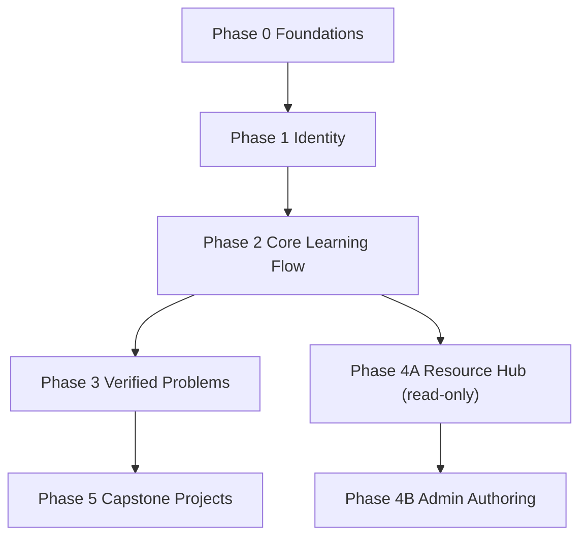

# TalebElm Product Roadmap

> **Status discipline:** Every phase and deliverable is marked **Implemented** (present in code today), **Target** (decided for MVP rollout), or **Proposed** (design pending team decision).
> All backend implementation follows Clean Architecture conventions described in [`docs/ARCHITECTURE.md`](../ARCHITECTURE.md).

---

## Roadmap Overview

> Phase 4A runs in parallel with Phases 1 to 3 and has zero direct dependency.
Phase 0 includes the DI baseline, content guards, validation errors, cancellation tokens, migration-chain tests, and API wiring. Phase 3 includes the `CompletedRequiredProblems` migration and the `ProgressResponse` counts.

## Phase 0: Foundations & Architecture Baseline

- **Status:** Target (In Progress)
- **Goal:** Establish a rock-solid, fully testable Clean Architecture baseline with zero runtime DI ambiguities, clean controller delegations, and corrected database integrity constraints.
- **Scope:**
  - Consolidate Dependency Injection registrations across `AddApplication()`, `AddInfrastructure()`, and `Program.cs` (Issue #274).
  - Add a comprehensive full-graph DI resolution test (`DependencyResolutionTests`) ensuring all services, repositories, validators, and `IUnitOfWork` resolve without runtime exceptions.
  - Wire placeholder API controllers (`TracksController`, `ModulesController`, `LessonsController`, `ExamsController`) to call existing application services rather than throwing `NotImplementedException`.
  - Fix PassThreshold constraint in database from `0–100` to `1–100` to eliminate bypass vulnerability (#326 resolved).
  - Standardize error handling and ProblemDetails mapping (#321 and `ValidationException` -> field-keyed errors).
- **Dependencies:** None.
- **Exit Criteria:**
  - `dotnet run --project src/TalebElm.Api` boots cleanly with no DI configuration warnings or exceptions.
  - Full-graph DI integration test passes in Release and Debug modes.
  - Existing endpoints return valid JSON or correct HTTP status codes instead of `501 Not Implemented`.
  - Issue  with migration and test.
- **Issue Areas:** `architecture`, `layer:infrastructure`, `layer:application`, `layer:api`, `database`.

---

## Phase 1: Identity & Authentication

- **Status:** Target
- **Goal:** Provide secure, standards-compliant user registration, authentication, JWT token issuance, and role-based policy enforcement.
- **Scope:**
  - Registration endpoint (`POST /api/auth/register`) validating email uniqueness case-insensitively and password complexity.
  - Authentication endpoint (`POST /api/auth/login`) issuing signed JWT bearer tokens with `UserId` and `Role` claims.
  - Password hashing utilizing the existing PBKDF2 `PasswordHasher` (`Implemented`).
  - Configure ASP.NET Core Authentication and Authorization middleware in `Program.cs`.
  - Define and test authorization policies: `StudentOnly` (`Student`, with `Admin` override) and `AdminOnly`.
  - Current-user context resolution: extract `UserId` from `ClaimsPrincipal` in controllers and pass explicitly to Application services.
- **Dependencies:** Phase 0 (DI and controller baseline).
- **Exit Criteria:**
  - Unauthenticated requests to protected endpoints return `401 Unauthorized`.
  - Forbidden actions (e.g., student calling admin endpoints) return `403 Forbidden`.
  - Registration rejects duplicate emails with `409 Conflict`.
  - Login returns signed JWTs with verified claims; passwords are never logged or stored in plaintext.
- **Issue Areas:** `feature:auth`, `layer:application`, `layer:api`, `security`.

---

## Phase 2: Core Learning Flow (Exams & Progression)

- **Status:** Target
- **Goal:** Complete the end-to-end Track study loop: track enrollment, lesson delivery, multiple-choice question storage, server-side grading, and sticky forward-only module unlocking.
- **Scope:**
  - Track enrollment workflow (`POST /api/tracks/{trackId}/enrollment`): creates `TrackEnrollment` and unlocks the first Module (`IsUnlocked = true`). Rejects duplicates with `409 Conflict`.
  - Exam question entities (`ExamQuestion`, `ExamOption`): multiple-choice schema, order, points, and server-only `IsCorrect`.
  - Server-side exam grading (`POST /api/exams/{id}/submit`): receives submitted answer IDs, computes score from stored answer key, updates `UserProgress` (latest score wins, `PassedExam` is sticky).
  - Progression gating: enforce `403 Forbidden` when an unauthorized or locked module/lesson/exam is accessed.
  - User progress query endpoints (`GET /api/progress/me`, `GET /api/progress/me/tracks/{trackId}`).
- **Dependencies:** Phase 0, Phase 1.
- **Exit Criteria:**
  - Learner can enroll in a published track and automatically unlock Module 1.
  - Learner answers exam questions; score is graded strictly on the server (client score input removed).
  - Passing score (`score >= PassThreshold`) sets `PassedExam = true` and unlocks the next Module in the Track.
  - Retaking a passed exam with a lower score never clears `PassedExam` (sticky).
  - Locked modules return `403 Forbidden`, never `404 Not Found`.
- **Issue Areas:** `feature:tracks`, `feature:exams`, `layer:domain`, `layer:application`, `layer:infrastructure`, `layer:api`.

---

## Phase 3: External Problems & Automated Verification

- **Status:** Target
- **Goal:** Integrate external coding problem platforms (Codeforces) and practical framework tasks (automated GitHub tasks), enforcing zero manual gating and dual-gated progression.
- **Scope:**
  - `ProblemKind` enum: `CodeforcesProblem` and `GitHubTask`, implemented behind `IProblemVerifier`.
  - `UserExternalAccount` entity & repository: stores Codeforces handle and GitHub OAuth numeric ID (`ExternalUserId`).
  - Codeforces handle verification: server issues 128-bit single-use token; learner pastes into Codeforces profile; platform verifies via public `user.info` API.
  - Codeforces solve verification: queries public `user.status` for `verdict == "OK"` matching `contestId` and problem `index`. All-time accepted solves count. Enforces 60s per-user debouncing.
  - Automated GitHub tasks (CodeCrafters-style): official starter template repositories (`Tawjjeh/task-<slug>-template`), GitHub REST API client (`IGitHubClient`), checking repository ownership, template provenance, latest workflow run success, and cryptographic blob/tree SHA matches against `TaskVersion`.
  - Unified `UserProblemCompletion` entity.
  - Dual-gated atomic progression: Module unlock check evaluates after BOTH exam submission and problem verification inside one `UnitOfWork` transaction.
- **Dependencies:** Phase 2.
- **Exit Criteria:**
  - Learner links and verifies Codeforces handle via profile token without sharing credentials.
  - Learner solves Codeforces problems; platform verifies solves via public API with 60s debouncing and fail-safe 503 error handling.
  - Learner completes framework task by pushing to GitHub default branch; platform automatically verifies test success and SHA integrity.
  - A learner with a passing exam but incomplete practice problems remains locked out of the next module.
  - Zero human-in-the-loop manual review or checklist gating.
- **Issue Areas:** `feature:problems` (proposed label), `layer:domain`, `layer:infrastructure`, `layer:application`, `layer:api`.

---

## Phase 4: Public Resource Hub

- **Status:** Target (Read-only Hub) / Target (Admin Authoring) / Proposed (Community Submissions)
- **Goal:** Provide a public, anonymous, highly curated index of programming resources organized in a 3-click hierarchy (`Language` → `Framework/Technology` → `Topic` → `Resources`), sharing one unified resource model with Lessons.
- **Scope:**
  - **Phase 4A (Read-only Public Hub - Target):**
    - `Technology` hierarchical self-referencing tree entity (`ParentId`, `Slug`, `Name`, `Description`, `Kind`, `Order`).
    - `Resource` entity with metadata: `Title`, `Url`, `Citation`, `Kind`, `Language`, `Level`, `IsPaid`, `Status`.
    - Public read-only endpoints: `GET /api/hub/technologies`, `GET /api/hub/technologies/{slug}`, `GET /api/hub/topics/{id}/resources` with pagination, keyword search, and filters (`language`, `level`, `isPaid`, `kind`).
    - Anonymous access: zero authentication required for reading.
  - **Phase 4B (Admin Authoring & Shared Model Migration - Target):**
    - Admin CRUD endpoints for technologies, topics, and resources.
    - Two-step non-destructive migration: Step 1 adds `Resource` and backfills from existing `LessonResource` rows; Step 2 retires duplicated columns, making `LessonResource` a join entity (`LessonId`, `ResourceId`, `Order`, `Note`).
    - Scheduled background link checker hosted service: probes resource URLs, tracking failures and marking resources `Broken` after 3 consecutive failures.
  - **Phase 4C (Community Submissions - Proposed):**
    - Community submissions running automated safety checks (HTTPS, domain blocklist, reachability probe) before entering an admin approval queue.
- **Dependencies:** Phase 0 (for 4A read-only). Phase 1 (for 4B/4C authoring). Can proceed in parallel with Phases 1–3.
- **Exit Criteria:**
  - Visitors can browse from Language to Topic in ≤ 3 clicks and search/filter resources without logging in.
  - Admin can curate and publish resources.
  - Lesson resources and Hub resources share one underlying `Resource` entity.
  - Broken links are automatically detected and hidden from public views.
- **Issue Areas:** `feature:resources` (proposed label), `layer:domain`, `layer:application`, `layer:infrastructure`, `layer:api`.

---

## Phase 5: Capstone Projects

- **Status:** Target
- **Goal:** Build a single cumulative portfolio project across the entire Track, split into ordered milestones verified automatically via GitHub tasks.
- **Scope:**
  - `CapstoneProject` entity attached to Track.
  - `ProjectMilestone` entity: ordered milestones defining incremental deliverables, each referencing an automated `GitHubTask`.
  - `UserMilestoneProgress` entity: records automated test pass and verified commit SHA.
  - Automated verification: each milestone is verified by the exact same automated GitHub task verification pipeline (CodeCrafters-style).
  - Derived Track completion: learner completes Track when all Modules are passed AND all Capstone Milestones are verified.
  - Zero manual gating: peer or mentor feedback is optional and non-blocking.
- **Dependencies:** Phase 2, Phase 3.
- **Exit Criteria:**
  - Learners can view project milestones in order and submit repository names for automated verification.
  - Milestone unlock is forward-only, sticky, and 100% automated.
  - Track completion is derived automatically upon completion of the final milestone.
- **Issue Areas:** `feature:capstone` (proposed label), `layer:domain`, `layer:application`, `layer:api`.
