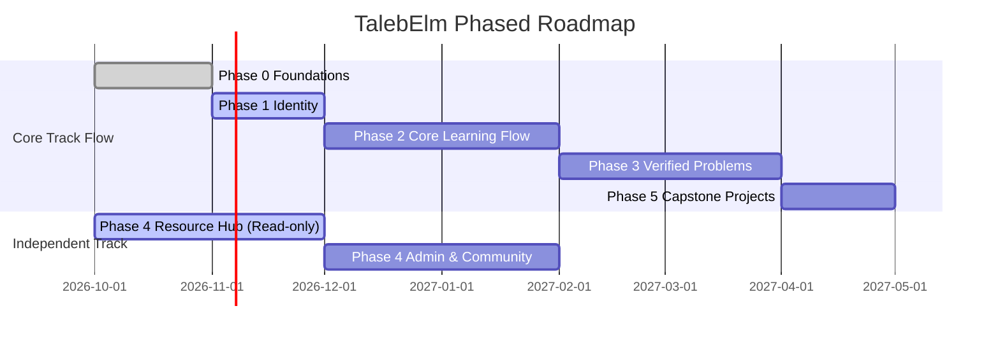

# TalebElm Product Roadmap

> **Status discipline:** Every phase and deliverable is marked **Implemented** (present in code today), **Target** (decided for MVP rollout), or **Proposed** (design pending team decision).
> All backend implementation follows Clean Architecture conventions described in [`docs/ARCHITECTURE.md`](../ARCHITECTURE.md).

---

## Roadmap Overview

> **Parallel Execution:** Phase 4's read-only Resource Hub has **zero dependencies** on Phases 1–3 and runs in parallel to attract visitors, community contributors, and public visibility early.

---

## Phase 0: Foundations & Architecture Baseline

- **Status:** Target (In Progress)
- **Goal:** Establish a rock-solid, fully testable Clean Architecture baseline with zero runtime DI ambiguities, clean controller delegations, and corrected database integrity constraints.
- **Scope:**
  - Consolidate Dependency Injection registrations across `AddApplication()`, `AddInfrastructure()`, and `Program.cs` (Issue #274).
  - Add a comprehensive full-graph DI resolution test (`DependencyResolutionTests`) ensuring all services, repositories, validators, and `IUnitOfWork` resolve without runtime exceptions.
  - Wire placeholder API controllers (`TracksController`, `ModulesController`, `LessonsController`, `ExamsController`) to call existing application services rather than throwing `NotImplementedException`.
  - Fix PassThreshold constraint in database from `0–100` to `1–100` to eliminate bypass vulnerability (Issue #326).
  - Standardize error handling and ProblemDetails mapping (Issues #321, #322).
- **Dependencies:** None.
- **Exit Criteria:**
  - `dotnet run --project src/TalebElm.Api` boots cleanly with no DI configuration warnings or exceptions.
  - Full-graph DI integration test passes in Release and Debug modes.
  - Existing endpoints return valid JSON or correct HTTP status codes instead of `501 Not Implemented`.
  - Issue #326 closed with migration and test.
- **Issue Areas:** `architecture`, `layer:infrastructure`, `layer:application`, `layer:api`, `database`.

---

## Phase 1: Identity & Authentication

- **Status:** Target
- **Goal:** Provide secure, standards-compliant user registration, authentication, JWT token issuance, and role-based policy enforcement.
- **Scope:**
  - Registration endpoint (`POST /api/auth/register`) validating email uniqueness case-insensitively and password complexity.
  - Authentication endpoint (`POST /api/auth/login`) issuing signed JWT bearer tokens with `UserId` and `Role` claims.
  - Password hashing utilizing the existing PBKDF2 `PasswordHasher` (`Implemented`).
  - Configure ASP.NET Core Authentication and Authorization middleware in `Program.cs`.
  - Define and test authorization policies: `StudentOnly` (`Student`, with `Admin` override) and `AdminOnly`.
  - Current-user context resolution: extract `UserId` from `ClaimsPrincipal` in controllers and pass explicitly to Application services.
- **Dependencies:** Phase 0 (DI and controller baseline).
- **Exit Criteria:**
  - Unauthenticated requests to protected endpoints return `401 Unauthorized`.
  - Forbidden actions (e.g., student calling admin endpoints) return `403 Forbidden`.
  - Registration rejects duplicate emails with `409 Conflict`.
  - Login returns signed JWTs with verified claims; passwords are never logged or stored in plaintext.
- **Issue Areas:** `feature:auth`, `layer:application`, `layer:api`, `security`.

---

## Phase 2: Core Learning Flow (Exams & Progression)

- **Status:** Target
- **Goal:** Complete the end-to-end Track study loop: track enrollment, lesson delivery, multiple-choice question storage, server-side grading, and sticky forward-only module unlocking.
- **Scope:**
  - Track enrollment workflow (`POST /api/tracks/{trackId}/enrollment`): creates `TrackEnrollment` and unlocks the first Module (`IsUnlocked = true`). Rejects duplicates with `409 Conflict`.
  - Exam question entities (`ExamQuestion`, `ExamOption`): multiple-choice schema, order, points, and server-only `IsCorrect`.
  - Server-side exam grading (`POST /api/exams/{id}/submit`): receives submitted answer IDs, computes score from stored answer key, updates `UserProgress` (latest score wins, `PassedExam` is sticky).
  - Progression gating: enforce `403 Forbidden` when an unauthorized or locked module/lesson/exam is accessed.
  - User progress query endpoints (`GET /api/progress/me`, `GET /api/progress/me/tracks/{trackId}`).
- **Dependencies:** Phase 0, Phase 1.
- **Exit Criteria:**
  - Learner can enroll in a published track and automatically unlock Module 1.
  - Learner answers exam questions; score is graded strictly on the server (client score input removed).
  - Passing score (`score >= PassThreshold`) sets `PassedExam = true` and unlocks the next Module in the Track.
  - Retaking a passed exam with a lower score never clears `PassedExam` (sticky).
  - Locked modules return `403 Forbidden`, never `404 Not Found`.
- **Issue Areas:** `feature:tracks`, `feature:exams`, `layer:domain`, `layer:application`, `layer:infrastructure`, `layer:api`.

---

## Phase 3: External Problems & Automated Verification

- **Status:** Target
- **Goal:** Integrate external coding problem platforms (Codeforces) and practical framework tasks, enforcing dual-gated progression (exam pass **and** problem completion).
- **Scope:**
  - `UserExternalAccount` entity & repository: handle, verification challenge, verification status (`Target`).
  - Codeforces handle verification challenge flow: platform generates a challenge problem; learner submits failing code (compilation error); platform verifies ownership via `user.status` Codeforces API (`Target`).
  - `ModuleProblem` entity & repository: attaches Codeforces problems or GitHub tasks to modules with order and required flags (`Target`).
  - `UserProblemCompletion` entity: records verified problem completion and external submission metadata (`Target`).
  - Problem verification service: queries public Codeforces API with local caching, rate limiting (~1 req / 2s), and debouncing (`Target`).
  - Practical framework tasks: learner submits a GitHub repository URL for manual or checklist review in the MVP (`Proposed`).
  - Update Module unlock condition: Module N unlocks **only** when Module N-1 has `PassedExam = true` **and** all required `ModuleProblem` entries are verified (`Target`).
- **Dependencies:** Phase 2.
- **Exit Criteria:**
  - Learner links and verifies a Codeforces handle without sharing passwords or private credentials.
  - Learner solves an assigned Codeforces problem; platform verifies the solve via the public API and marks it completed.
  - A learner with a passing exam but incomplete practice problems remains locked out of the next module.
  - Rate limiting and caching protect against Codeforces API throttling and temporary outages.
- **Issue Areas:** `feature:problems` (proposed label), `layer:domain`, `layer:infrastructure`, `layer:application`, `layer:api`.

---

## Phase 4: Public Resource Hub

- **Status:** Target (Read-only Hub) / Proposed (Admin & Community Authoring)
- **Goal:** Provide a public, anonymous, highly curated index of programming resources organized in a 3-click hierarchy (`Language` $\to$ `Framework/Technology` $\to$ `Topic` $\to$ `Resources`).
- **Scope:**
  - **Phase 4A (Read-only Public Hub - Target):**
    - `Technology` hierarchical tree entity (`ParentId`, `Slug`, `Name`, `Description`, `Kind`, `Order`).
    - `Resource` entity with metadata: `Title`, `Url`, `Citation`, `Kind`, `Language`, `Level`, `IsPaid`, `Status`.
    - Public read-only endpoints: `GET /api/hub/technologies`, `GET /api/hub/technologies/{slug}`, `GET /api/hub/topics/{id}/resources` with query filtering (`language`, `level`, `isPaid`).
    - Anonymous access: zero authentication required for reading.
  - **Phase 4B (Admin Authoring & Moderation - Target):**
    - Admin CRUD endpoints for technologies, topics, and resources.
    - Status workflow: `PendingApproval`, `Approved`, `Rejected`.
  - **Phase 4C (Community Submissions - Proposed):**
    - Authenticated community submissions with moderation queue and review checklist.
  - **Unified Model Migration:** Evaluate migration of existing `LessonResource` entity to point to the shared `Resource` catalog (Open Decision #25).
- **Dependencies:** Phase 0 (for 4A read-only). Phase 1 (for 4B/4C authoring). Can proceed in parallel with Phases 1–3.
- **Exit Criteria:**
  - Visitors can browse from Language to Topic in $\le$ 3 clicks without logging in.
  - Resources can be filtered by human language (Arabic, English), level, and cost.
  - Admin can curate and publish resources.
- **Issue Areas:** `feature:resources` (proposed label), `layer:domain`, `layer:application`, `layer:infrastructure`, `layer:api`.

---

## Phase 5: Capstone Projects

- **Status:** Proposed
- **Goal:** Provide real-world portfolio capstone projects at the end of Tracks, ensuring learners graduate with job-ready practical experience.
- **Scope:**
  - `Project` entity: title, description, architecture requirements, grading rubric.
  - `Milestone` entity: ordered milestones defining incremental deliverables.
  - `ProjectSubmission` entity: learner repository URL, submission notes, review status (`Submitted`, `UnderReview`, `Approved`, `NeedsRevision`).
  - Settle architectural format: single capstone at track completion vs. cumulative project developed across track modules (Open Decision #27).
  - Admin/mentor review workflow with evaluation checklist.
- **Dependencies:** Phase 2, Phase 3.
- **Exit Criteria:**
  - Learners reaching the end of a Track can view capstone requirements and submit their GitHub repository.
  - Mentors/Admins can review submissions, provide feedback, and record approval.
  - Track completion requires approved capstone project.
- **Issue Areas:** `feature:capstone` (proposed label), `layer:domain`, `layer:application`, `layer:api`.
