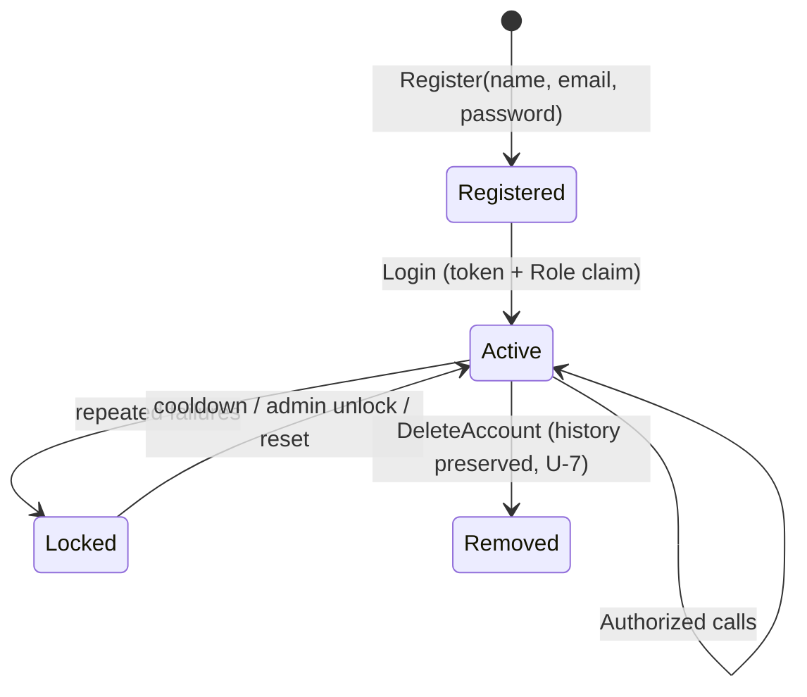
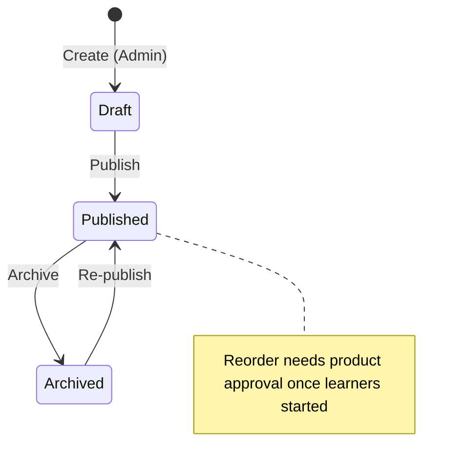
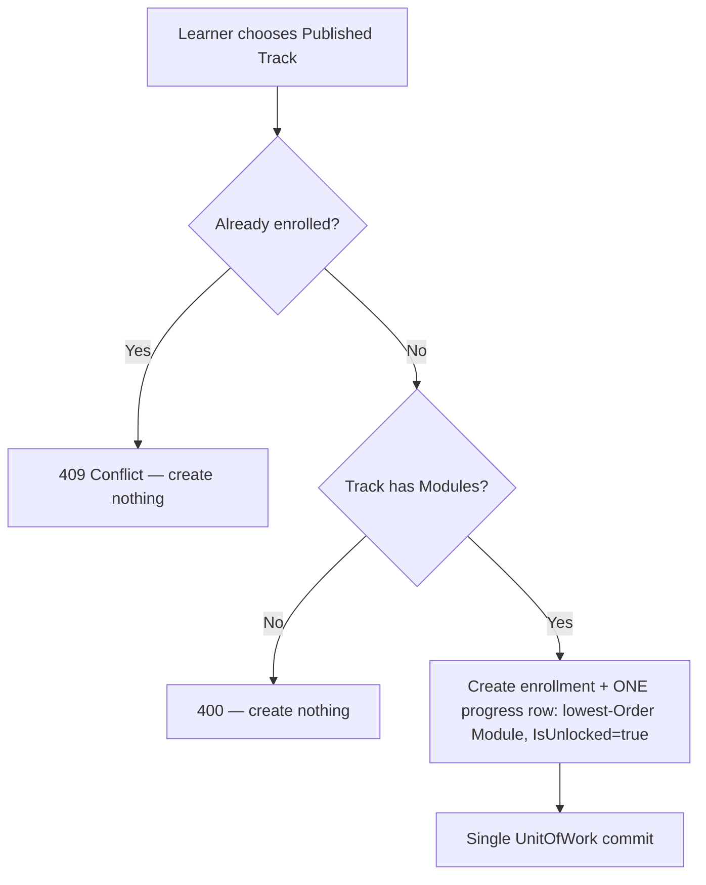
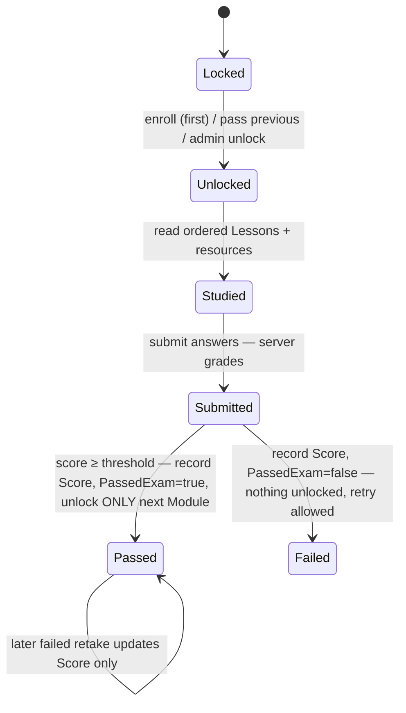
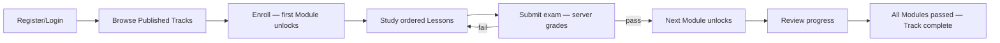

# TalebElm Workflows & State Transitions

> Companion to `BUSINESS_RULES.md` — the rules are normative; this file maps the **processes**.
> Rule IDs (U/C/E/A/P) refer to that file. Implementation maturity per step is in
> `docs/FEATURE_INDEX.md`; the HTTP surface is owned by `docs/API_ENDPOINTS.md`.

## 1. Authentication lifecycle

| Step | Behavior | Rules |
|---|---|---|
| Register | Validate U-1…U-3; duplicate email → `409`; hash with salted slow algorithm; `Role = Student`; `JoinedAt` = server UTC. No token for duplicate, no partial user on failure. | U-1–U-5 |
| Login | Unknown email **or** wrong password → indistinguishable `401`. Success returns token; hash never leaves the server. | U-3, U-6 |
| Authorize | `StudentOnly` (Student; Admin override): browse, enroll, study, exams, own progress. `AdminOnly`: content writes, user management, manual unlock. `Instructor` is defined but has no distinct MVP permissions. | D-1, §5 |

## 2. Track lifecycle (content authoring)

| Transition | Guard (all-or-nothing) |
|---|---|
| Create | Admin only. Starts `Draft`; invisible to learners. |
| Publish | Track has ≥ 1 Module; all `Order` values valid and contiguous; lengths within bounds. |
| Archive | Always allowed. Enrollments and progress untouched. |
| Delete | Blocked (`409`) while Modules, enrollments, or progress reference the Track. No `Draft` regression after publishing. |

## 3. Enrollment flow

Rules E-1…E-4. Identity comes from auth, never from the request body.

## 4. Study → exam → unlock loop

| Event | Effect |
|---|---|
| Submit | Server computes `Score`; overwrites row `Score`; sets `PassedExam` only upward. |
| Pass | Unlock next Module in same Track (create its row if missing). Final Module: terminal. |
| Fail | State change limited to the current row. Immediate retry permitted. |
| Locked read/submit/view | `403`, not `404`. Cross-learner access `403`. |

## 5. Learner journey end to end

Completion is derived from progress rows (P-5). Scheduling, payments, certificates, and attempt history are out of the MVP scope.

## 6. Failure → status map

| Situation | Status | Rule |
|---|---|---|
| Duplicate email / enrollment / exam-per-Module | `409`, nothing created | U-2, E-2, A-3 |
| Blank / oversize / bad URL / bad `Order` | `400` field-keyed errors | U-1, C-3 |
| Unknown id | `404` | — |
| Locked content, cross-learner access, self-unlock | `403` | P-3, P-4 |
| Missing / invalid token | `401` | U-6 |
| Delete with dependents | `409`, nothing deleted; archive instead | C-6 |
| Unimplemented placeholder | `501` | Technical, not a business state |
