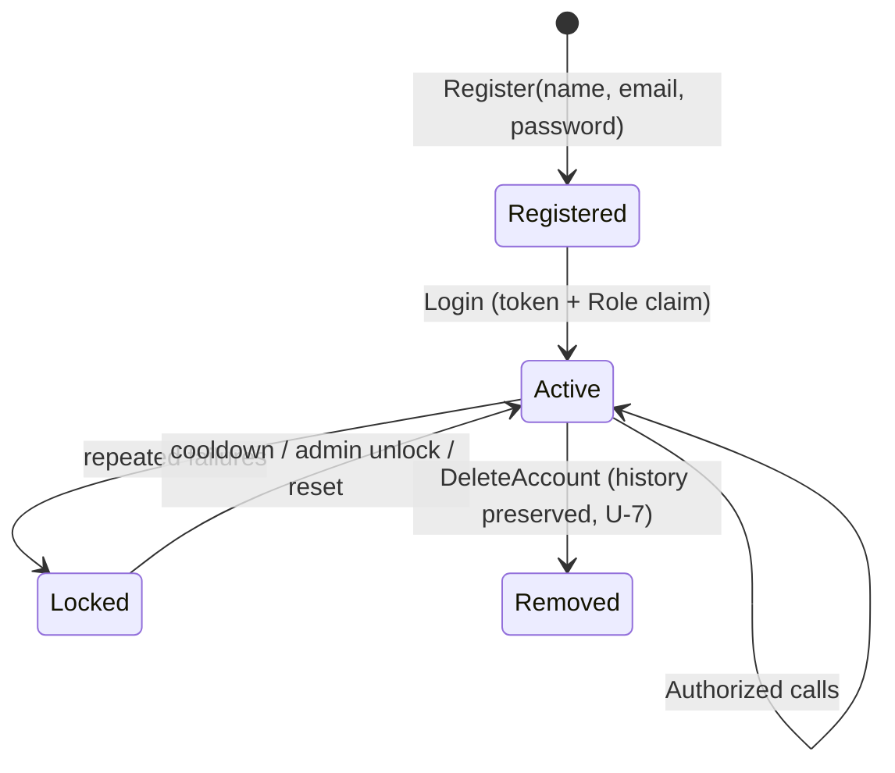
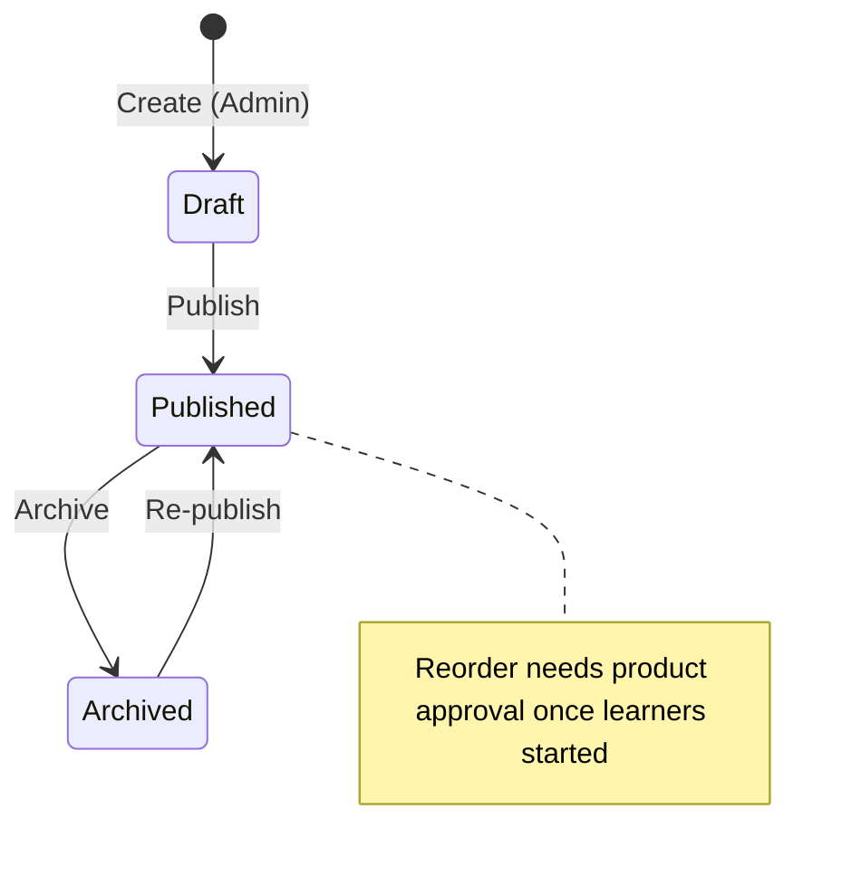
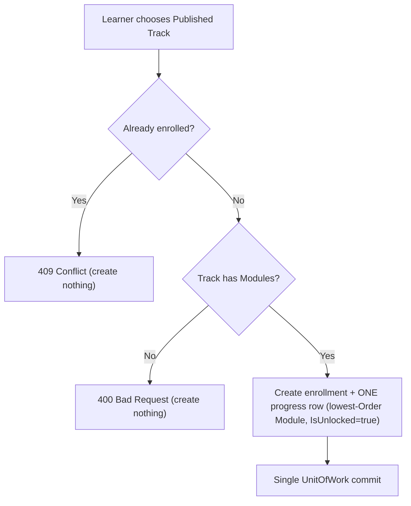
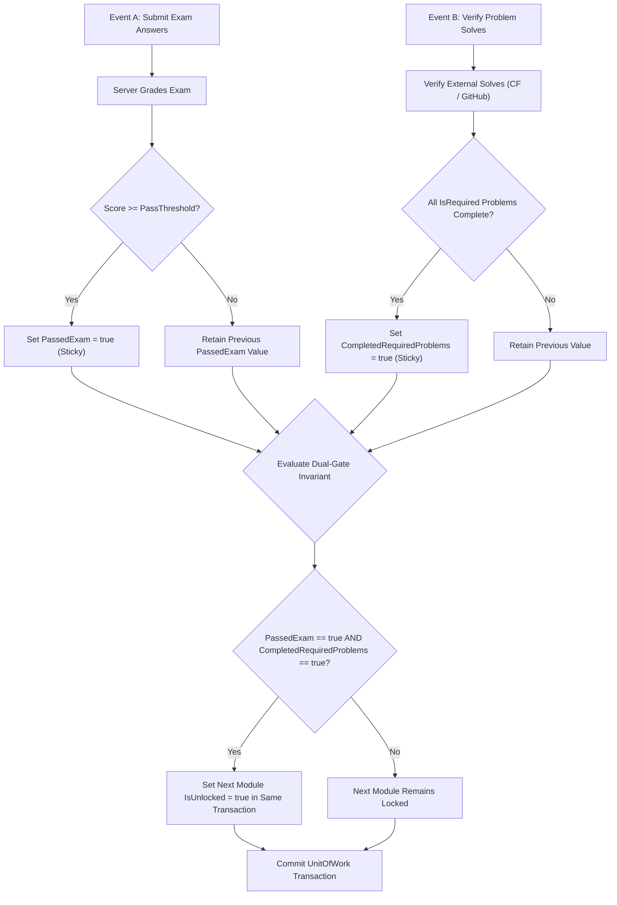
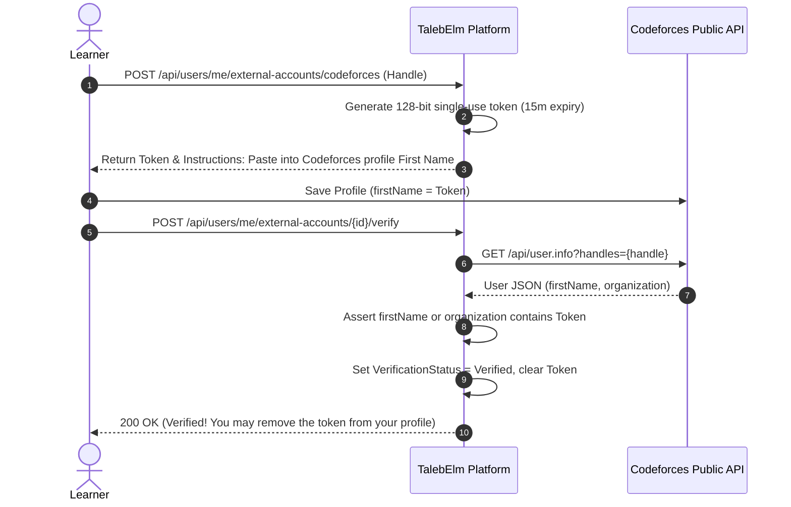
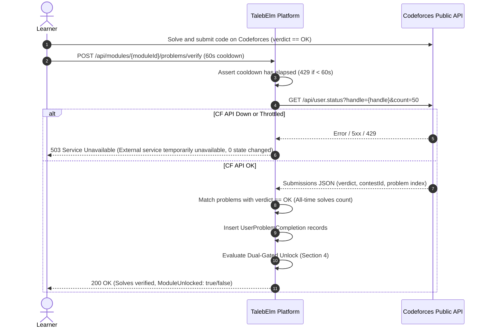
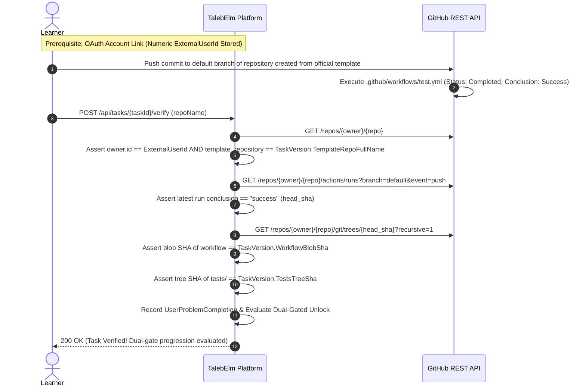
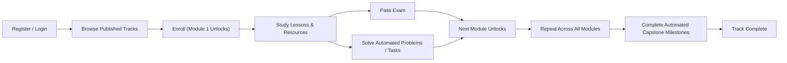

# TalebElm Workflows & State Transitions

> Companion to `BUSINESS_RULES.md` — the rules are normative; this file maps the **processes**.
> Rule IDs (U/C/E/A/P) refer to that file. Implementation maturity per step is in
> `docs/FEATURE_INDEX.md`; the HTTP surface is owned by `docs/API_ENDPOINTS.md`.

## 1. Authentication lifecycle

| Step | Behavior | Rules |
|---|---|---|
| Register | Validate U-1…U-3; duplicate email → `409`; hash with salted slow algorithm; `Role = Student`; `JoinedAt` = server UTC. No token for duplicate, no partial user on failure. | U-1–U-5 |
| Login | Unknown email **or** wrong password → indistinguishable `401`. Success returns token; hash never leaves the server. | U-3, U-6 |
| Authorize | `StudentOnly` (Student; Admin override): browse, enroll, study, exams, own progress. `AdminOnly`: content writes, user management, manual unlock. `Instructor` is defined but has no distinct MVP permissions. | D-1, §5 |

## 2. Track lifecycle (content authoring)

| Transition | Guard (all-or-nothing) |
|---|---|
| Create | Admin only. Starts `Draft`; invisible to learners. |
| Publish | Track has ≥ 1 Module; all `Order` values valid and contiguous; lengths within bounds. |
| Archive | Always allowed. Enrollments and progress untouched. |
| Delete | Blocked (`409`) while Modules, enrollments, or progress reference the Track. No `Draft` regression after publishing. |

## 3. Enrollment flow

Rules E-1…E-4. Identity comes from auth, never from the request body.

## 4. Dual-Gated Unlock Check (Atomic UnitOfWork Evaluation)

The unlock check runs after **either** event occurs (submitting an exam OR verifying practice problems) inside a single `UnitOfWork` transaction:

| Invariant Trigger | Condition | Transactional Action |
|---|---|---|
| Exam Submission | Score ≥ threshold | Sets `PassedExam = true`. If all required problems were already completed, unlocks next Module. |
| Problem Verification | All required problems verified | Sets `CompletedRequiredProblems = true`. If exam was already passed, unlocks next Module. |
| Single Transaction | Atomic commit | Row creation/update of current module and unlock of next module committed in one `UnitOfWork` commit. |

---

## 5. Codeforces Verification Workflows

### 5.1 Handle Ownership Verification via Profile Token

### 5.2 Problem Solve Verification

---

## 6. Automated GitHub Task Verification Workflow (CodeCrafters-Style)

---

## 7. Resource Hub 3-Click Discovery & Curation Flow

```mermaid
flowchart TD
    subgraph Discovery["Public Anonymous Discovery (3 Clicks + Search/Pagination)"]
        V1["GET /api/hub/technologies"] -->|"Click 1: Select Language (C#)"| V2["GET /api/hub/technologies/csharp"]
        V2 -->|"Click 2: Select Framework (ASP.NET Core)"| V3["GET /api/hub/technologies/aspnet-core"]
        V3 -->|"Click 3: Select Topic (Dependency Injection)"| V4["GET /api/hub/topics/{id}/resources"]
        V4 --> V5["View Paged Results with Filters (Language, Level, Cost, Title Search)"]
    end

    subgraph HealthChecker["Automated Link Health Background Service"]
        H1["Scheduled Timer Fires Daily"] --> H2["Fetch Active Resources"]
        H2 --> H3["Send HTTP HEAD Probe to Resource URL"]
        H3 -- 2xx/3xx Success --> H4["Reset Failure Count to 0"]
        H3 -- 4xx/5xx/Timeout --> H5["Increment Failure Count"]
        H5 --> H6{"Failure Count >= 3?"}
        H6 -- Yes --> H7["Set Status = Broken (Hidden from Public Lists)"]
        H6 -- No --> H8["Keep Current Status"]
    end
```

---

## 8. Learner Journey End-to-End

---

## 9. Failure → Status Map

| Situation | Status | Rule |
|---|---|---|
| Duplicate email / enrollment / exam-per-Module | `409 Conflict`, nothing created | U-2, E-2, A-3 |
| Blank / oversize / bad URL / bad `Order` | `400 Bad Request` field-keyed errors | U-1, C-3, R-3 |
| Unknown id | `404 Not Found` | — |
| Locked content, incomplete prerequisites, cross-learner access | `403 Forbidden` | P-2, P-4, J-2 |
| Missing / invalid / expired token | `401 Unauthorized` | U-6 |
| Delete with dependents | `409 Conflict`, nothing deleted; archive instead | C-6 |
| Codeforces / GitHub API rate limit | `429 Too Many Requests` (per-user throttle) | X-3, Decision 31 |
| External provider downtime / network failure | `503 Service Unavailable` (fail-safe; 0 state changed) | X-6, Decision 31 |
| Tampered GitHub task test suite / workflow SHA mismatch | `400 Bad Request` (`IntegrityShaMismatch`) | Decision 35 |
