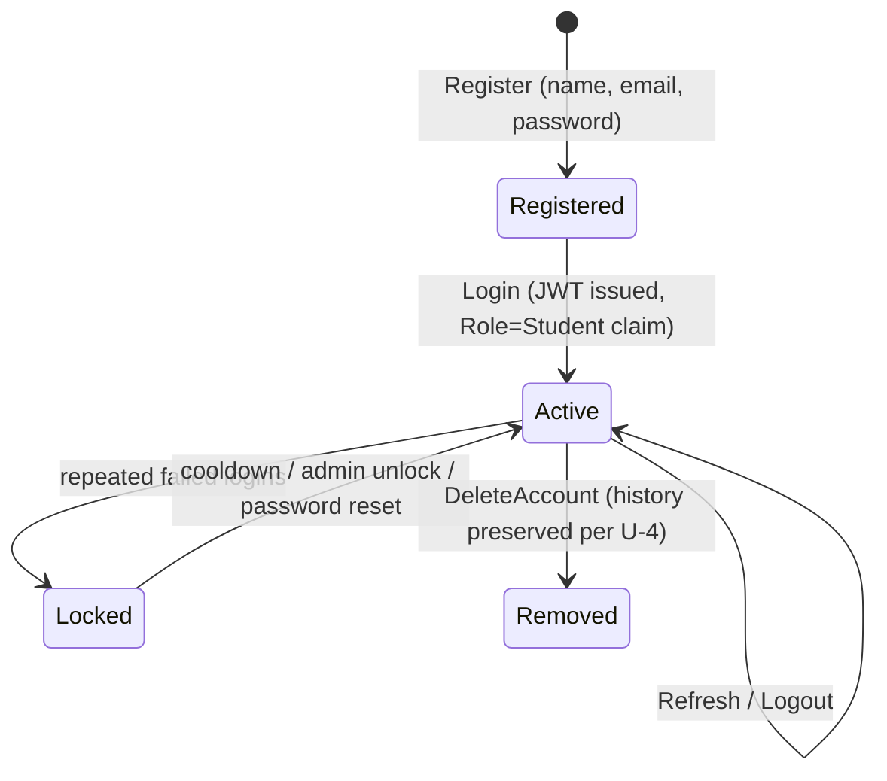
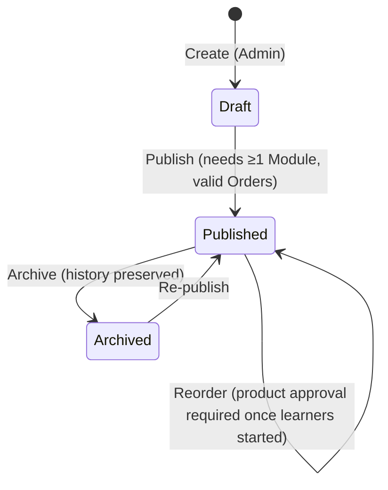
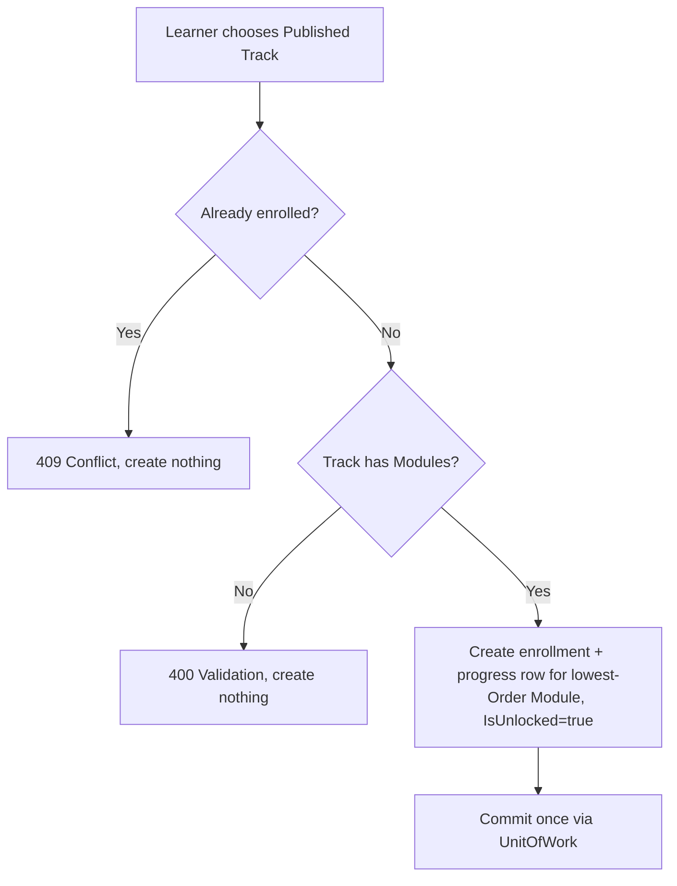
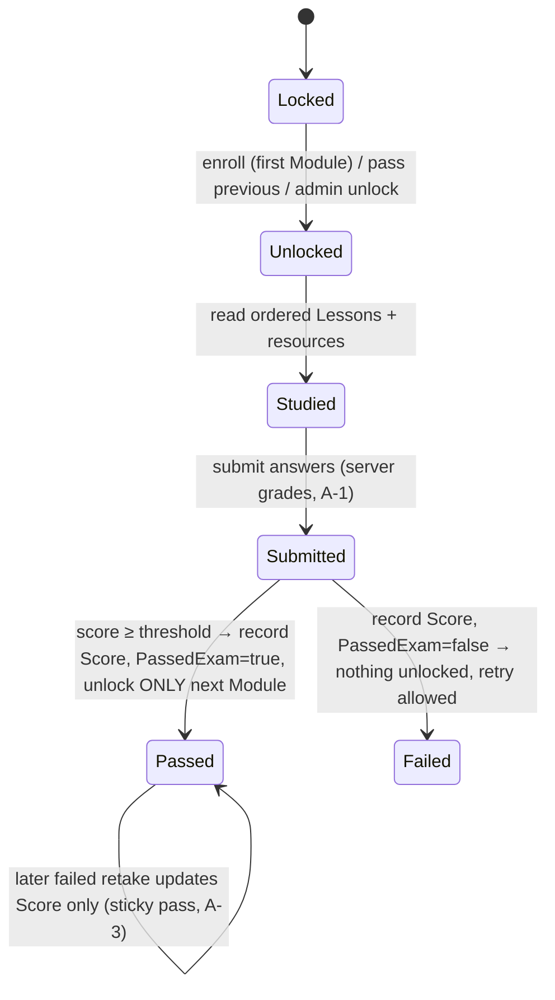

# TalebElm Business Workflows & State Transitions

> Companion to `BUSINESS_RULES.md` (the rules) — this file maps the **processes**.
> Rule IDs (U/T/L/E/A) refer to that file. Feature status per step is in
> `docs/FEATURE_INDEX.md`; `docs/API_ENDPOINTS.md` owns the HTTP surface.

## 1. User authentication lifecycle

| Step | Business behavior |
|---|---|
| Register | Validate (U-1); duplicate email → `409`; hash with salted slow algorithm; default `Role = Student`; `JoinedAt` = server UTC. |
| Login | Unknown email **or** wrong password → `401`, indistinguishable. Issue token with role claim; never return hash. |
| Authorization | `LearnerOnly` (Student, Instructor, Admin): browse, enroll, study, exams, own progress. `AdminOnly`: content writes, user management, manual unlock. |

## 2. Track lifecycle (content authoring)

| Transition | Guard |
|---|---|
| Create | Admin; starts `Draft`, invisible to learners (T-1). |
| Publish | ≥ 1 Module; contiguous valid `Order`; Modules/Lessons within length bounds (T-2, T-3). |
| Archive | Always allowed; enrollments + progress untouched (T-5). |
| Delete | Blocked with `409` while Modules, enrollments, or progress reference the Track (T-5). There is no `Draft` regression after publishing. |

## 3. Enrollment flow

Rules E-1…E-4 apply. No request body: Track id from route, User id from auth identity.

## 4. Study → exam → unlock loop (per Module)

| Event | Effect |
|---|---|
| Submit (server-graded) | Overwrites `Score`; sets `PassedExam = true` on pass, never clears it later (A-3). |
| Pass | Unlock next Module in same Track (create its progress row if missing). Final Module: nothing further (A-4). |
| Fail | Nothing unlocked; learner may retry immediately (A-3). |
| Locked-module read/submit/view | `403`, not `404` (A-6). |

## 5. Track completion

A Track is complete for a learner when every Module's progress row has `PassedExam = true` (Modules without an Exam complete via explicit unlock per A-2). Completion is derived from progress rows — no separate completion record exists in the MVP.

## 6. Failure & conflict map

| Situation | Result | Rule |
|---|---|---|
| Duplicate email / enrollment / exam-per-Module | `409 Conflict`, nothing created | U-3, E-2, A-2 |
| Invalid input (blank, oversize, bad URL, bad Order) | `400` field-keyed errors | U-1, T-2, L-1/2 |
| Missing id | `404` | — |
| Locked content, cross-learner access, self-unlock attempt | `403` | A-5, A-6 |
| Missing/invalid token | `401` | §1 |
| Delete with dependents | `409`, delete nothing; archive instead | T-5 |
