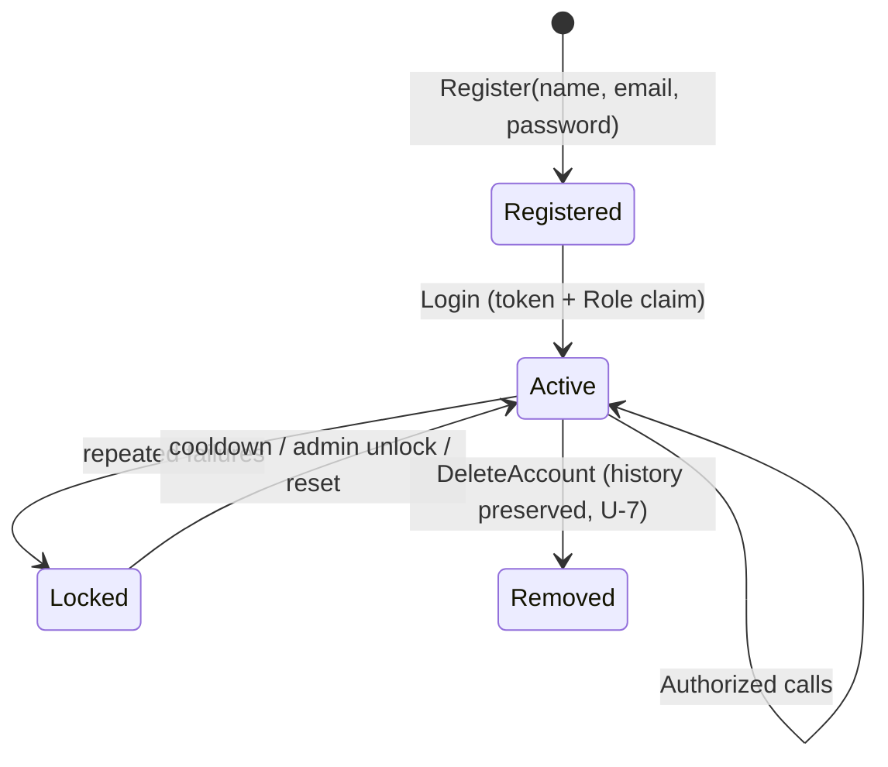
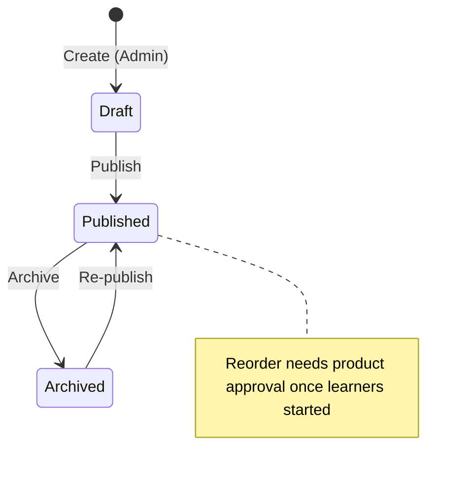
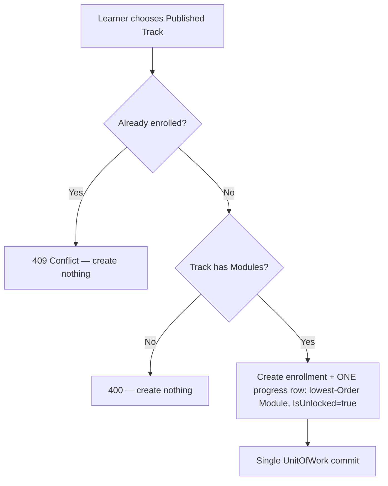
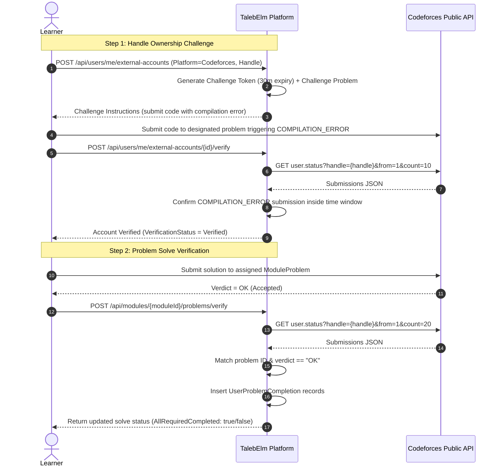
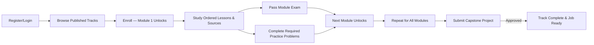

# TalebElm Workflows & State Transitions

> Companion to `BUSINESS_RULES.md` — the rules are normative; this file maps the **processes**.
> Rule IDs (U/C/E/A/P) refer to that file. Implementation maturity per step is in
> `docs/FEATURE_INDEX.md`; the HTTP surface is owned by `docs/API_ENDPOINTS.md`.

## 1. Authentication lifecycle



| Step | Behavior | Rules |
|---|---|---|
| Register | Validate U-1…U-3; duplicate email → `409`; hash with salted slow algorithm; `Role = Student`; `JoinedAt` = server UTC. No token for duplicate, no partial user on failure. | U-1–U-5 |
| Login | Unknown email **or** wrong password → indistinguishable `401`. Success returns token; hash never leaves the server. | U-3, U-6 |
| Authorize | `StudentOnly` (Student; Admin override): browse, enroll, study, exams, own progress. `AdminOnly`: content writes, user management, manual unlock. `Instructor` is defined but has no distinct MVP permissions. | D-1, §5 |

## 2. Track lifecycle (content authoring)



| Transition | Guard (all-or-nothing) |
|---|---|
| Create | Admin only. Starts `Draft`; invisible to learners. |
| Publish | Track has ≥ 1 Module; all `Order` values valid and contiguous; lengths within bounds. |
| Archive | Always allowed. Enrollments and progress untouched. |
| Delete | Blocked (`409`) while Modules, enrollments, or progress reference the Track. No `Draft` regression after publishing. |

## 3. Enrollment flow



Rules E-1…E-4. Identity comes from auth, never from the request body.

## 4. Study → exam + problems → unlock loop (Dual-Gated)

```mermaid
flowchart TD
    Locked[Module Locked] -->|Enrollment / Previous Module Completed| Unlocked[Module Unlocked]
    Unlocked --> Study[Study Ordered Lessons & Resources]
    Study --> G1{Take Module Exam}
    Study --> G2{Solve Practice Problems}
    
    G1 -- Submit Answers --> Grade[Server Grades Exam]
    Grade -- Score < PassThreshold --> ExamFailed[Exam Failed — Retry Allowed]
    Grade -- Score >= PassThreshold --> ExamPassed[PassedExam = true (Sticky)]
    
    G2 -- Submit Codeforces / GitHub --> Verify[Platform Verifies Solves via API]
    Verify -- Missing Required Solves --> ProblemsIncomplete[Problems Incomplete — Continue Solving]
    Verify -- All Required Solves Verified --> ProblemsPassed[CompletedRequiredProblems = true (Sticky)]
    
    ExamPassed --> CheckBoth{PassedExam AND CompletedRequiredProblems?}
    ProblemsPassed --> CheckBoth
    
    CheckBoth -- Yes --> UnlockNext[Unlock ONLY Next Module in Track]
    CheckBoth -- No --> WaitOther[Wait for Remaining Requirement]
```

| Event | Effect | Rules |
|---|---|---|
| Submit Exam | Server computes `Score`; overwrites row `Score`; sets `PassedExam = true` if $\ge$ threshold. Failed retake never resets `PassedExam`. | A-1, A-4 |
| Verify Problems | Platform verifies external solves via API; sets `CompletedRequiredProblems = true` once all required problems pass. Never resets once `true`. | X-1, X-3 |
| Dual-Gate Pass | When **both** `PassedExam` and `CompletedRequiredProblems` are `true`, unlock the next Module in the same Track in the same `UnitOfWork` transaction. | P-2 |
| Locked content read/submit | `403 Forbidden`, not `404`. Cross-learner access `403`. | P-4 |

---

## 5. External Account Verification & Problem Solve Flow



---

## 6. Resource Hub 3-Click Discovery & Curation Flow

```mermaid
flowchart TD
    subgraph Public Anonymous Visitor (<= 3 Clicks)
        V1[Visit Resource Hub: GET /api/hub/technologies] -->|Click 1: Choose Language| V2[Select Language e.g. C#]
        V2 -->|Click 2: Choose Framework| V3[Select Framework e.g. ASP.NET Core]
        V3 -->|Click 3: Choose Topic| V4[Select Topic e.g. Dependency Injection]
        V4 --> V5[View Curated Resources with Filters: Language, Level, Cost]
    end

    subgraph Admin Curation & Moderation
        A1[Admin Authenticates] --> A2[Create/Update Technology Node]
        A2 --> A3[Create Resource with Status = Approved]
        A4[Future: Community Submits Resource] --> A5[Status: PendingApproval]
        A5 --> A6{Admin Review}
        A6 -- Approve --> A7[Status: Approved — Visible Publicly]
        A6 -- Reject --> A8[Status: Rejected with Feedback]
    end
```

---

## 7. Learner Journey End-to-End



---

## 8. Failure → Status Map

| Situation | Status | Rule |
|---|---|---|
| Duplicate email / enrollment / exam-per-Module | `409 Conflict`, nothing created | U-2, E-2, A-3 |
| Blank / oversize / bad URL / bad `Order` | `400 Bad Request` field-keyed errors | U-1, C-3, R-3 |
| Unknown id | `404 Not Found` | — |
| Locked content, incomplete prerequisites, cross-learner access | `403 Forbidden` | P-2, P-4, J-2 |
| Missing / invalid / expired token | `401 Unauthorized` | U-6 |
| Delete with dependents | `409 Conflict`, nothing deleted; archive instead | C-6 |
| Codeforces API down / rate limit exceeded | `429 Too Many Requests` (user throttle) / `503 Service Unavailable` | X-5 |
| Unimplemented placeholder | `501 Not Implemented` | Technical, not a business state |
