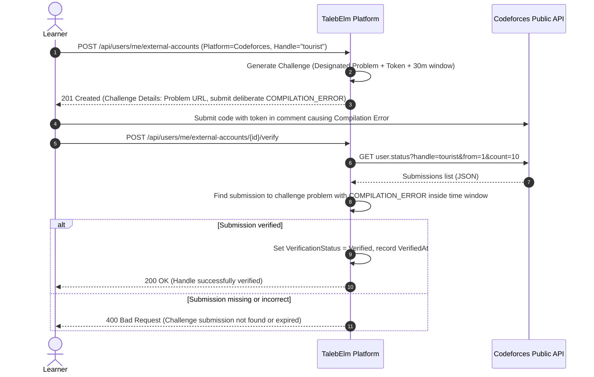

# Feature Specification: Module Practice Problems & External Verification

> **Status discipline:** All entities, contracts, and endpoints in this specification are marked **Target** (decided for implementation) or **Proposed** (design pending team decision). None are currently Implemented in code.
> External API rules are marked **"Verify against official docs (codeforces.com/apiHelp)"**.

---

## 1. Scope & Objective

To transition learners from passive concept absorption to job-ready engineering proficiency, every Module features practical exercises alongside its exam:

- **Fundamentals Modules (Algorithms & Syntax):** Practice problems are sourced from external competitive programming platforms (Codeforces in scope). The platform verifies handle ownership via a cryptographic challenge submission and verifies solves directly via public APIs (`Target`). The learner never self-reports problem completion.
- **Framework Modules (Real-world Architecture):** Algorithmic problems do not fit framework concepts (e.g., ASP.NET Core, EF Core, Spring Boot). Learners submit a public GitHub repository URL, evaluated manually or by structured checklist in the MVP (`Target`). Automated grading via GitHub Actions is planned for a future phase (`Proposed`).
- **Dual-Gated Sticky Progression:** To unlock the next Module in a Track, the learner must **both** pass the Module Exam (`PassedExam = true`) **and** complete all required practice problems (`CompletedRequiredProblems = true`) (`Target`). Both flags are sticky and cannot be revoked by later attempts.
- **Extensible Platform Abstraction:** The domain model uses an enum (`ExternalPlatform`) and an external problem identifier (`ExternalId`), allowing future platforms (e.g., LeetCode, HackerRank) without altering schema foundations (`Target`).

---

## 2. Database & Domain Contract

### 2.1 Entity: UserExternalAccount (Target)

Stores a learner's linked profile on an external platform and tracks its ownership verification status.

| Field | Type | Nullable | Constraints / Notes | Status |
|---|---|---|---|---|
| `Id` | `Guid` | No | PK, inherited from `BaseEntity` | Target |
| `CreatedAt` | `DateTimeOffset` | No | Inherited from `BaseEntity`, UTC | Target |
| `UserId` | `Guid` | No | Required FK to `User.Id`. Delete behavior: `Restrict`. | Target |
| `Platform` | `ExternalPlatform` | No | Enum: `Codeforces = 1`, `GitHub = 2`. `UNIQUE(UserId, Platform)`. | Target |
| `Handle` | `string` | No | Platform username / handle. Max length **64**, non-blank. | Target |
| `VerificationStatus` | `AccountVerificationStatus` | No | Enum: `PendingChallenge = 1`, `Verified = 2`, `Failed = 3`. | Target |
| `VerificationChallengeToken` | `string?` | Yes | Unique challenge string (or designated contest/problem + submission requirements) generated by the platform. | Target |
| `ChallengeExpiresAt` | `DateTimeOffset?` | Yes | Challenge expiration timestamp (e.g., 30 minutes from generation). | Target |
| `VerifiedAt` | `DateTimeOffset?` | Yes | Timestamp when ownership was successfully verified. | Target |

### 2.2 Entity: ModuleProblem (Target)

Defines an assigned practice problem or practical task associated with a Module.

| Field | Type | Nullable | Constraints / Notes | Status |
|---|---|---|---|---|
| `Id` | `Guid` | No | PK, inherited from `BaseEntity` | Target |
| `CreatedAt` | `DateTimeOffset` | No | Inherited from `BaseEntity`, UTC | Target |
| `ModuleId` | `Guid` | No | Required FK to `Module.Id`. Delete behavior: `Restrict`. | Target |
| `Platform` | `ExternalPlatform` | No | Enum: `Codeforces = 1`, `GitHub = 2`. | Target |
| `ExternalId` | `string` | No | Unique problem key on the platform (e.g., `4A`, `158B` on Codeforces, or task template slug). Max length **100**. | Target |
| `Title` | `string` | No | Display title shown to the learner (e.g., "Watermelon - Basic Conditionals"). Max length **200**. | Target |
| `Url` | `string` | No | Direct absolute URL to the problem or task instructions. Max length **500**. | Target |
| `Order` | `int` | No | Display order within the Module (1, 2, 3...). `UNIQUE(ModuleId, Order)`. | Target |
| `IsRequired` | `bool` | No | If `true`, must be completed to unlock the next module. If `false`, optional bonus problem. Default `true`. | Target |

### 2.3 Entity: UserProblemCompletion (Target)

Records that a learner has verified completion of a specific `ModuleProblem`.

| Field | Type | Nullable | Constraints / Notes | Status |
|---|---|---|---|---|
| `Id` | `Guid` | No | PK, inherited from `BaseEntity` | Target |
| `CreatedAt` | `DateTimeOffset` | No | Inherited from `BaseEntity`, UTC | Target |
| `UserId` | `Guid` | No | Required FK to `User.Id`. Delete behavior: `Restrict`. | Target |
| `ModuleProblemId` | `Guid` | No | Required FK to `ModuleProblem.Id`. Delete behavior: `Restrict`. `UNIQUE(UserId, ModuleProblemId)`. | Target |
| `CompletedAt` | `DateTimeOffset` | No | Timestamp of completion verification. | Target |
| `ExternalSubmissionId` | `string?` | Yes | Identifier of the verified solve on the external platform (e.g., Codeforces submission ID). | Target |
| `SubmissionUrl` | `string?` | Yes | Repository URL for framework tasks (GitHub). | Target |
| `ReviewStatus` | `TaskReviewStatus?` | Yes | For manual tasks: `Submitted = 1`, `Approved = 2`, `NeedsRevision = 3`. Null for Codeforces. | Target |

### 2.4 Updated Progression Invariant: UserProgress

The existing `UserProgress` entity (`src/TalebElm.Domain/Entities/UserProgress.cs`, `Implemented`) currently tracks `PassedExam` and `Score`.

To enforce dual gating, `UserProgress` must incorporate problem completion:
- **Field Addition:** `CompletedRequiredProblems: bool` (default `false`, sticky once `true`).
- **Unlock Predicate:** Next Module unlocks if and only if:
  $$\text{IsUnlocked}_{\text{next}} \iff \text{PassedExam}_{\text{current}} = \text{true} \land \text{CompletedRequiredProblems}_{\text{current}} = \text{true}$$
- Both flags are sticky: passing an exam and later failing a retake does not re-lock; completing problems is permanently recorded.

---

## 3. External Verification Workflows

### 3.1 Codeforces Handle Verification Flow

To prevent users from linking handles belonging to other people, the platform issues an active challenge:



> **API Verification Reference:**
> Verify against official docs (`codeforces.com/apiHelp`).
> Method: `user.status`. Parameters: `handle`, `from`, `count`.
> Verdicts inspected: `COMPILATION_ERROR` for handle challenge, `OK` for problem solves.

### 3.2 Problem Solve Verification Flow

1. Learner visits an unlocked Module and opens an assigned Codeforces problem.
2. Learner solves and submits the problem on Codeforces.
3. Learner clicks **"Verify Solves"** on TalebElm (`POST /api/modules/{moduleId}/problems/verify`).
4. TalebElm checks cache / debounce limit (prevents spamming external API).
5. TalebElm queries `user.status` for the learner's verified handle.
6. For each required `ModuleProblem`, TalebElm checks if an accepted submission (`verdict == "OK"`) exists with matching `contestId` and problem `index`.
7. For each matched solve, a `UserProblemCompletion` record is inserted (idempotent).
8. If all required problems for the module are completed:
   - Set `UserProgress.CompletedRequiredProblems = true`.
   - If `UserProgress.PassedExam == true`, unlock the next Module (`IsUnlocked = true`).

---

## 4. Rate-Limiting & Caching Strategy

- **Codeforces Public API Restrictions:** 
  - Official recommendation: at most 1 request every 2 seconds from the same IP address (*Verify against official docs*).
  - Exceeding the limit results in HTTP 403 or JSON `{"status": "FAILED", "comment": "Call limit exceeded"}`.
- **Platform Mitigations:**
  1. **Debounce / User Throttling:** A learner may trigger solve verification at most once every 30 seconds per module. Subsequent calls return cached results or `429 Too Many Requests`.
  2. **External Outbound Queue / Semaphore:** All outbound HTTP calls to Codeforces pass through a rate-limited queue enforcing a strict minimum 2-second interval between outbound requests.
  3. **Local Response Caching:** Recent submission responses for a handle are cached in-memory (e.g., 60 seconds TTL) to avoid redundant round-trips when multiple problems are verified in the same module.
  4. **Circuit Breaker:** If Codeforces returns repeated 5xx errors or connection timeouts, the platform gracefully returns a clear message: `"External verification service is temporarily unavailable. Please try again in a few minutes."`

---

## 5. Failure Modes & Edge Cases

| Failure Mode | Impact | Handling & Recovery |
|---|---|---|
| **Codeforces API Downtime** | Learner cannot verify handle or problem solves. | Return friendly 503/ProblemDetails indicating external provider downtime. Do not fail platform transactions; keep local progress safe. |
| **Handle Not Verified** | Learner attempts to verify solves without an active handle. | Reject solve verification with `400 Bad Request` ("External account handle must be verified first"). |
| **Problem Removed / Contest Deleted** | An assigned problem URL becomes a 404 on Codeforces. | Admin must update or replace the `ModuleProblem` record. Learners who already completed it retain their `UserProblemCompletion` record. |
| **Solve Pre-dates Registration** | Learner solved the problem years ago before joining TalebElm. | The `user.status` API returns the historic solve with `verdict == "OK"`. Unless product policy explicitly demands a fresh solve (see [Open Decision #29](../OPEN_DECISIONS.md)), historic solves are credited as valid completions. |

---

## 6. Application Contracts & DTOs

### 6.1 DTOs (Target)

```csharp
public record LinkExternalAccountRequest(
    int Platform,
    string Handle);

public record ExternalAccountResponse(
    Guid Id,
    int Platform,
    string Handle,
    int VerificationStatus,
    string? VerificationChallengeToken,
    DateTimeOffset? ChallengeExpiresAt,
    DateTimeOffset? VerifiedAt);

public record ModuleProblemResponse(
    Guid Id,
    Guid ModuleId,
    int Platform,
    string ExternalId,
    string Title,
    string Url,
    int Order,
    bool IsRequired,
    bool IsCompleted);

public record SubmitTaskRepositoryRequest(
    Guid ModuleProblemId,
    string RepositoryUrl);

public record TaskSubmissionResponse(
    Guid Id,
    Guid ModuleProblemId,
    string RepositoryUrl,
    int ReviewStatus,
    DateTimeOffset SubmittedAt);

public record VerifySolvesResponse(
    int TotalRequired,
    int TotalCompleted,
    bool AllRequiredCompleted,
    IReadOnlyList<ModuleProblemResponse> Problems);
```

### 6.2 Service Interface (Target)

```csharp
public interface IModuleProblemService
{
    Task<IReadOnlyList<ModuleProblemResponse>> GetProblemsForModuleAsync(Guid moduleId, Guid userId);
    Task<ExternalAccountResponse> LinkAccountAsync(Guid userId, LinkExternalAccountRequest request);
    Task<ExternalAccountResponse> VerifyAccountChallengeAsync(Guid accountId, Guid userId);
    Task<VerifySolvesResponse> VerifyModuleSolvesAsync(Guid moduleId, Guid userId);
    Task<TaskSubmissionResponse> SubmitFrameworkTaskAsync(Guid userId, SubmitTaskRepositoryRequest request);
}
```

---

## 7. API Endpoints Contract

| HTTP Method | Route | Access | Request | Response | Status Codes |
|---|---|---|---|---|---|
| `GET` | `/api/modules/{moduleId}/problems` | **Student** | None | `ModuleProblemResponse[]` | `200 OK`, `401 Unauthorized`, `403 Forbidden` (if module locked), `404 Not Found` |
| `POST` | `/api/users/me/external-accounts` | **Student** | `LinkExternalAccountRequest` | `ExternalAccountResponse` | `201 Created`, `400 Bad Request`, `409 Conflict` |
| `POST` | `/api/users/me/external-accounts/{id}/verify` | **Student** | None | `ExternalAccountResponse` | `200 OK`, `400 Bad Request`, `404 Not Found` |
| `POST` | `/api/modules/{moduleId}/problems/verify` | **Student** | None | `VerifySolvesResponse` | `200 OK`, `400 Bad Request`, `403 Forbidden`, `429 Too Many Requests` |
| `POST` | `/api/modules/{moduleId}/tasks/submit` | **Student** | `SubmitTaskRepositoryRequest` | `TaskSubmissionResponse` | `201 Created`, `400 Bad Request`, `403 Forbidden` |
| `POST` | `/api/admin/modules/{moduleId}/problems` | **AdminOnly** | `CreateModuleProblemRequest` | `ModuleProblemResponse` | `201 Created`, `400 Bad Request`, `403 Forbidden` |

---

## 8. Domain Exceptions

| Exception | Scenario | HTTP Status |
|---|---|---|
| `ValidationException` | Invalid handle format, expired verification challenge, empty GitHub URL. | `400 Bad Request` |
| `ConflictException` | Handle already linked to another user on the same platform; duplicate problem `Order`. | `409 Conflict` |
| `NotFoundException` | Module or problem does not exist. | `404 Not Found` |
| `DomainException` | Attempting to access problems or submit tasks for a locked Module. | `403 Forbidden` |

---

## 9. Acceptance Criteria

- [ ] A learner cannot verify problem solves on an external platform without first completing handle verification.
- [ ] Handle challenge requires a submission within the challenge time window with a compilation error.
- [ ] Completing an exam does not unlock the next Module if required problems remain incomplete.
- [ ] Completing all required problems does not unlock the next Module if the exam is not passed.
- [ ] Unlocking occurs immediately when both conditions are satisfied, in the same transaction.
- [ ] Locked module problem endpoints return `403 Forbidden`, never `404 Not Found`.
- [ ] Rapid verification clicks are debounced and do not trigger concurrent external requests.
