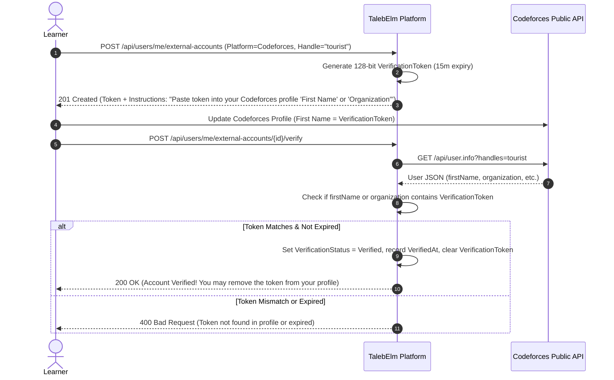

# Feature Specification: Module Practice Problems & External Verification

> **Status discipline:** All entities, contracts, and endpoints in this specification are marked **Target** (decided for implementation in Phase 3). None are currently Implemented in code.
> Adheres strictly to the **Zero Manual Gating** principle: all verification is executed automatically by the server.
> External API rules are marked **"Verify against official docs (codeforces.com/apiHelp)"**.

---

## 1. Scope & Objective

To transition learners from passive concept absorption to job-ready engineering proficiency, every Module features practical exercises alongside its exam:

- **Problem Kinds (`ProblemKind` Enum):**
  1. `CodeforcesProblem`: Algorithmic problems on Codeforces for fundamentals modules (`Target`).
  2. `GitHubTask`: CodeCrafters-style automated repository tasks for framework modules (`Target`, detailed in [`10-automated-task-verification.md`](10-automated-task-verification.md)).
- **Zero Manual Gating:** Neither instructors nor admins manually grade or unlock practice problems. Codeforces solves are verified via public APIs, and framework tasks are verified via automated GitHub Actions and SHA integrity checks.
- **Codeforces Profile Token Verification:** Handle ownership is verified without third-party passwords. The server generates a random 128-bit single-use token (expires in 15 minutes) that the learner temporarily places in a profile field (such as `firstName` or `organization`) returned by the public `user.info` method. The platform reads the profile and verifies ownership.
- **Automated Solve Verification:** The platform queries `user.status` to confirm an `OK` verdict matching `contestId` and problem `index`. All-time accepted solves count (including solves completed before platform registration).
- **Dual-Gated Sticky Progression:** A Module unlocks its successor only when **both** hold:
  1. The Module Exam is passed (`PassedExam = true`), if the Module has an exam.
  2. Every problem marked `IsRequired` is completed (`CompletedRequiredProblems = true`), if the Module has problems.
  - If a Module has only an exam, only the exam is required. If a Module has only problems, only problems are required. If it has neither, progression follows the explicit admin-unlock rule. Optional problems are bonus and never block.
  - Both `PassedExam` and problem completion are sticky once achieved.
- **Difficulty Calibration:** Each `ModuleProblem` caches the Codeforces problem rating. In the first Module of a Track, problems must be rated 800 or lower, rising gradually in later modules. This is an authoring guideline and a soft validator warning, not a hard block.

---

## 2. Database & Domain Contract

### 2.1 Entity: UserExternalAccount (Target)

Stores a learner's linked profile on an external platform and tracks its ownership verification status.

| Field | Type | Nullable | Constraints / Notes | Status |
|---|---|---|---|---|
| `Id` | `Guid` | No | PK, inherited from `BaseEntity` | Target |
| `CreatedAt` | `DateTimeOffset` | No | Inherited from `BaseEntity`, UTC | Target |
| `UserId` | `Guid` | No | Required FK to `User.Id`. Delete behavior: `Restrict`. | Target |
| `Platform` | `ExternalPlatform` | No | Enum: `Codeforces = 1`, `GitHub = 2`. `UNIQUE(UserId, Platform)`. | Target |
| `Handle` | `string` | No | Platform username / handle. Max length **64**, non-blank. `UNIQUE(Platform, Handle)` for verified accounts. | Target |
| `ExternalUserId` | `long?` | Yes | Numeric user id (used by GitHub). Nullable for Codeforces. | Target |
| `VerificationStatus` | `AccountVerificationStatus` | No | Enum: `PendingChallenge = 1`, `Verified = 2`, `Failed = 3`. | Target |
| `VerificationToken` | `string?` | Yes | Cryptographically random single-use token (≥128 bits hex string). Max length **64**. | Target |
| `TokenExpiresAt` | `DateTimeOffset?` | Yes | 15 minutes from generation. | Target |
| `VerifiedAt` | `DateTimeOffset?` | Yes | Timestamp when ownership was successfully verified. | Target |

### 2.2 Entity: ModuleProblem (Target)

Defines an assigned practice problem associated with a Module.

| Field | Type | Nullable | Constraints / Notes | Status |
|---|---|---|---|---|
| `Id` | `Guid` | No | PK, inherited from `BaseEntity` | Target |
| `CreatedAt` | `DateTimeOffset` | No | Inherited from `BaseEntity`, UTC | Target |
| `ModuleId` | `Guid` | No | Required FK to `Module.Id`. Delete behavior: `Restrict`. | Target |
| `Kind` | `ProblemKind` | No | Enum: `CodeforcesProblem = 1`, `GitHubTask = 2`. | Target |
| `ExternalId` | `string` | No | Problem identifier (e.g., `4A`, `158B` on Codeforces; task slug for GitHub). Max length **100**. | Target |
| `Title` | `string` | No | Display title (e.g., "Watermelon - Basic Conditionals"). Max length **200**. | Target |
| `Url` | `string` | No | Direct absolute URL to the problem or task. Max length **500**. | Target |
| `Order` | `int` | No | Display order within Module (1, 2, 3...). `UNIQUE(ModuleId, Order)`. | Target |
| `IsRequired` | `bool` | No | If `true`, must be completed to unlock the next module. If `false`, optional bonus. Default `true`. | Target |
| `DifficultyRating` | `int?` | Yes | Cached Codeforces rating (e.g., 800, 1000). Soft validation warning if Module 1 problem has rating > 800. | Target |

### 2.3 Entity: UserProblemCompletion (Unified Model) (Target)

Records that a learner has verified completion of a specific `ModuleProblem`.

| Field | Type | Nullable | Constraints / Notes | Status |
|---|---|---|---|---|
| `Id` | `Guid` | No | PK, inherited from `BaseEntity` | Target |
| `CreatedAt` | `DateTimeOffset` | No | Inherited from `BaseEntity`, UTC | Target |
| `UserId` | `Guid` | No | Required FK to `User.Id`. Delete behavior: `Restrict`. | Target |
| `ModuleProblemId` | `Guid` | No | Required FK to `ModuleProblem.Id`. Delete behavior: `Restrict`. `UNIQUE(UserId, ModuleProblemId)`. | Target |
| `CompletedAt` | `DateTimeOffset` | No | Timestamp of completion verification. | Target |
| `ExternalSubmissionId` | `string?` | Yes | Codeforces submission ID or GitHub repository name. | Target |
| `VerifiedHeadCommitSha` | `string?` | Yes | For GitHub tasks: verified Git commit SHA. | Target |
| `TaskVersionId` | `Guid?` | Yes | For GitHub tasks: FK to `TaskVersion.Id`. | Target |

---

## 3. Workflows & Verification Algorithms

### 3.1 Codeforces Handle Verification Flow



> **API Verification Reference:**
> Verify against official docs (`codeforces.com/apiHelp`).
> Method: `user.info`. Parameters: `handles`.
> Inspected fields: `result[0].firstName`, `result[0].organization`.

### 3.2 Codeforces Problem Solve Verification Flow

1. Learner visits an unlocked Module, views assigned Codeforces problems, and submits code directly on Codeforces.
2. Learner clicks **"Verify My Solves"** on TalebElm (`POST /api/modules/{moduleId}/problems/verify`).
3. Platform checks rate limit: enforced per-user cooldown of **60 seconds**. If called within 60s, return `429 Too Many Requests`.
4. Platform calls `ICodeforcesClient.GetUserSubmissionsAsync(handle, count: 50)`.
5. If Codeforces API is down or throttled, return `503 Service Unavailable` with `"External verification service is temporarily unavailable"`. Alter **zero** learner state.
6. For each required `ModuleProblem` of kind `CodeforcesProblem`:
   - Match by `contestId` and problem `index` (parsed from `ExternalId`).
   - Check if any submission has `verdict == "OK"`.
   - All-time accepted solves count (including solves submitted prior to TalebElm registration).
7. For each matched problem not yet marked complete:
   - Insert `UserProblemCompletion` record.
8. **Dual-Gated Unlock Evaluation (Atomic):**
   - Check if all `IsRequired` problems for the Module are now completed.
   - Check if the Module Exam is passed (or if the Module has no Exam).
   - If both conditions are satisfied, set the next Module's progress `IsUnlocked = true`.
   - Commit all changes inside a single `UnitOfWork` transaction.

---

## 4. Application Contracts

### 4.1 DTOs (Target)

```csharp
public record LinkCodeforcesAccountRequest(
    string Handle);

public record ExternalAccountResponse(
    Guid Id,
    int Platform,
    string Handle,
    int VerificationStatus,
    string? VerificationToken,
    DateTimeOffset? TokenExpiresAt,
    DateTimeOffset? VerifiedAt);

public record ModuleProblemResponse(
    Guid Id,
    Guid ModuleId,
    int Kind,
    string ExternalId,
    string Title,
    string Url,
    int Order,
    bool IsRequired,
    int? DifficultyRating,
    bool IsCompleted);

public record VerifySolvesResponse(
    int TotalRequired,
    int TotalCompleted,
    bool AllRequiredCompleted,
    IReadOnlyList<ModuleProblemResponse> Problems,
    bool ModuleUnlocked);
```

### 4.2 Service Interfaces (Target)

```csharp
public interface IProblemVerifier
{
    ProblemKind Kind { get; }
    Task<bool> VerifyCompletionAsync(Guid userId, ModuleProblem problem);
}

public interface ICodeforcesClient
{
    Task<CodeforcesUserResponse?> GetUserInfoAsync(string handle);
    Task<IReadOnlyList<CodeforcesSubmissionResponse>> GetUserSubmissionsAsync(string handle, int count = 50);
}

public interface IModuleProblemService
{
    Task<IReadOnlyList<ModuleProblemResponse>> GetProblemsForModuleAsync(Guid moduleId, Guid userId);
    Task<ExternalAccountResponse> LinkCodeforcesAccountAsync(Guid userId, LinkCodeforcesAccountRequest request);
    Task<ExternalAccountResponse> VerifyCodeforcesHandleAsync(Guid accountId, Guid userId);
    Task<VerifySolvesResponse> VerifyModuleSolvesAsync(Guid moduleId, Guid userId);
}
```

---

## 5. API Endpoints Contract

| HTTP Method | Route | Access | Request | Response | Status Codes |
|---|---|---|---|---|---|
| `GET` | `/api/modules/{moduleId}/problems` | **Student** | None | `ModuleProblemResponse[]` | `200 OK`, `401 Unauthorized`, `403 Forbidden` (if module locked), `404 Not Found` |
| `POST` | `/api/users/me/external-accounts/codeforces` | **Student** | `LinkCodeforcesAccountRequest` | `ExternalAccountResponse` | `201 Created`, `400 Bad Request`, `409 Conflict` |
| `POST` | `/api/users/me/external-accounts/{id}/verify` | **Student** | None | `ExternalAccountResponse` | `200 OK`, `400 Bad Request`, `404 Not Found`, `503 Service Unavailable` |
| `POST` | `/api/modules/{moduleId}/problems/verify` | **Student** | None | `VerifySolvesResponse` | `200 OK`, `400 Bad Request`, `403 Forbidden`, `429 Too Many Requests`, `503 Service Unavailable` |
| `POST` | `/api/admin/modules/{moduleId}/problems` | **AdminOnly** | `CreateModuleProblemRequest` | `ModuleProblemResponse` | `201 Created`, `400 Bad Request`, `403 Forbidden` |

---

## 6. Acceptance Criteria

- [ ] A learner links a Codeforces handle; platform returns a 128-bit single-use token expiring in 15 minutes.
- [ ] Profile verification reads `user.info` via `ICodeforcesClient`; matching `firstName` or `organization` successfully verifies the account.
- [ ] A verified handle cannot be claimed by another user (`409 Conflict`).
- [ ] Solve verification matches Codeforces submissions where `verdict == "OK"` by `contestId` and `index`.
- [ ] Solve verification enforces a 60-second per-user cooldown returning `429 Too Many Requests`.
- [ ] External API downtime returns `503 Service Unavailable` with zero alteration of learner state.
- [ ] Completing all required problems triggers module unlock in the same transaction if the exam was already passed.
- [ ] Zero manual human review or checklist intervention is required at any step.

## Decision 33 and 34 update
One row per `(UserId, Platform)`. Filtered unique indexes apply to verified handles. `CompletedRequiredProblems` on `UserProgress` is sticky. `user.status` paging stops when every required problem is matched, and per-handle caching lasts 60 seconds.
