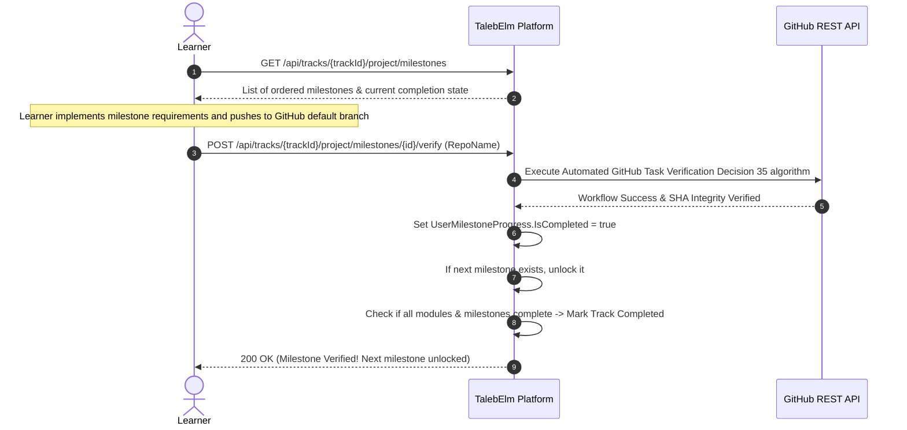

# Feature Specification: Cumulative Capstone Projects & Track Completion

> **Status discipline:** All entities, contracts, and endpoints in this specification are marked **Target** (decided for implementation in Phase 5). None are currently Implemented in code.
> Adheres strictly to the **Zero Manual Gating** principle: all milestone progress is verified automatically.

---

## 1. Scope & Objective

Rather than building isolated toy exercises, a Track culminates in a **single comprehensive portfolio project built progressively across the entire Track**:

- **Cumulative Milestones:** The capstone project is partitioned into ordered `ProjectMilestone`s (e.g., Milestone 1: Domain Model, Milestone 2: Persistence & Unit of Work, Milestone 3: Web API & Middlewares, Milestone 4: Docker & CI/CD).
- **Automated Milestone Verification:** Each milestone references an official `GitHubTask` (detailed in [`10-automated-task-verification.md`](10-automated-task-verification.md)). When a learner completes the requirements of a milestone, tests in their public repository pass and the server verifies completion automatically via the GitHub REST API and SHA integrity checks.
- **Derived Track Completion:** A Track is marked complete if and only if **all Modules are passed** AND **all capstone Milestones are verified**.
- **Optional Supplementary Mentorship:** While peer or mentor code reviews may be added as an optional learning enhancement in the future, they **never block** milestone unlocking, track completion, or certificates. Progression is 100% automated.

---

## 2. Database & Domain Contract

### 2.1 Entity: CapstoneProject (Target)

Represents the cumulative project definition attached to a Track.

| Field | Type | Nullable | Constraints / Notes | Status |
|---|---|---|---|---|
| `Id` | `Guid` | No | PK, inherited from `BaseEntity` | Target |
| `CreatedAt` | `DateTimeOffset` | No | Inherited from `BaseEntity`, UTC | Target |
| `TrackId` | `Guid` | No | Required FK to `Track.Id`. Delete behavior: `Restrict`. `UNIQUE(TrackId)` (exactly one capstone per track). | Target |
| `Title` | `string` | No | Project title (e.g., "Build an Enterprise E-Commerce Engine"). Max length **150**. | Target |
| `Description` | `string` | No | Architectural overview, technology stack, and high-level requirements. Max length **4000**. | Target |
| `StarterTemplateRepo` | `string` | No | GitHub repository template under `Tawjjeh/`. Max length **150**. | Target |

### 2.2 Entity: ProjectMilestone (Target)

Defines an ordered deliverable checkpoint within the cumulative project.

| Field | Type | Nullable | Constraints / Notes | Status |
|---|---|---|---|---|
| `Id` | `Guid` | No | PK, inherited from `BaseEntity` | Target |
| `CreatedAt` | `DateTimeOffset` | No | Inherited from `BaseEntity`, UTC | Target |
| `ProjectId` | `Guid` | No | Required FK to `CapstoneProject.Id`. Delete behavior: `Restrict`. | Target |
| `TaskId` | `Guid` | No | Required FK to `GitHubTask.Id`. Delete behavior: `Restrict`. Links to the automated verifier. | Target |
| `ModuleId` | `Guid?` | Yes | Optional link to the corresponding Track `Module.Id` if the milestone is tackled alongside that module. | Target |
| `Title` | `string` | No | Milestone title (e.g., "Milestone 2: Relational Persistence"). Max length **150**. | Target |
| `Instructions` | `string` | No | Specific milestone requirements and test suite guide. Max length **2000**. | Target |
| `Order` | `int` | No | Sequence number (1, 2, 3...). `UNIQUE(ProjectId, Order)`. | Target |

### 2.3 Milestone Progress: UserMilestoneProgress (Target)

Tracks the learner's completion of capstone milestones.

| Field | Type | Nullable | Constraints / Notes | Status |
|---|---|---|---|---|
| `Id` | `Guid` | No | PK, inherited from `BaseEntity` | Target |
| `CreatedAt` | `DateTimeOffset` | No | Inherited from `BaseEntity`, UTC | Target |
| `UserId` | `Guid` | No | Required FK to `User.Id`. Delete behavior: `Restrict`. | Target |
| `MilestoneId` | `Guid` | No | Required FK to `ProjectMilestone.Id`. Delete behavior: `Restrict`. `UNIQUE(UserId, MilestoneId)`. | Target |
| `IsCompleted` | `bool` | No | Marked `true` automatically once the linked `GitHubTask` passes verification. Sticky once `true`. | Target |
| `CompletedAt` | `DateTimeOffset?` | Yes | Timestamp of verified automated test pass. | Target |
| `RepositoryUrl` | `string?` | Yes | Learner's public GitHub repository URL. Max length **500**. | Target |
| `HeadCommitSha` | `string?` | Yes | Verified Git commit hash. | Target |

---

## 3. Automated Milestone Workflow

---

## 4. API Endpoints Contract

| HTTP Method | Route | Access | Request | Response | Status Codes |
|---|---|---|---|---|---|
| `GET` | `/api/tracks/{trackId}/project` | **Student** | None | `CapstoneProjectResponse` | `200 OK`, `401 Unauthorized`, `404 Not Found` |
| `GET` | `/api/tracks/{trackId}/project/milestones` | **Student** | None | `ProjectMilestoneResponse[]` | `200 OK`, `401 Unauthorized`, `404 Not Found` |
| `POST` | `/api/tracks/{trackId}/project/milestones/{id}/verify` | **Student** | `VerifyMilestoneRequest` | `MilestoneVerificationResponse` | `200 OK`, `400 Bad Request`, `401 Unauthorized`, `403 Forbidden`, `429 Too Many Requests`, `503 Service Unavailable` |
| `POST` | `/api/admin/tracks/{trackId}/project` | **AdminOnly** | `CreateCapstoneProjectRequest` | `CapstoneProjectResponse` | `201 Created`, `400 Bad Request`, `401 Unauthorized`, `403 Forbidden` |
| `POST` | `/api/admin/projects/{id}/milestones` | **AdminOnly** | `CreateProjectMilestoneRequest` | `ProjectMilestoneResponse` | `201 Created`, `400 Bad Request`, `401 Unauthorized`, `403 Forbidden` |

---

## 5. Acceptance Criteria

- [ ] Capstone is structured as ordered milestones building a single cumulative project.
- [ ] Milestone completion is 100% automated via the linked `GitHubTask` verification pipeline (CodeCrafters-style).
- [ ] No manual review or approval from an admin or mentor is required to unlock subsequent milestones or complete the track.
- [ ] Track completion is derived automatically when all Track Modules are passed and all Capstone Milestones are verified.

## Decision 36a update
`CapstoneProject` has one `GitHubTask` (`TaskId`), one template, one workflow, and one tests tree containing all milestone tests. `ProjectMilestone` drops `TaskId` and gains `WorkflowJobName`; final Module does not gate the capstone. Track completion is derived. Remove certificate wording from capstone completion descriptions.
